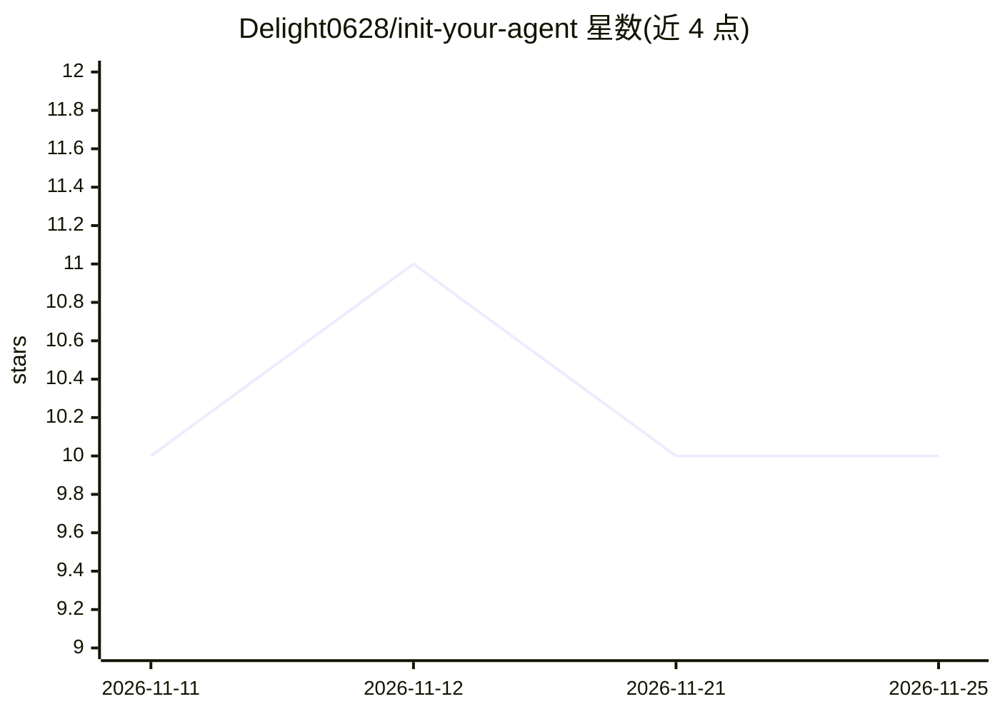

# Delight0628/init-your-agent

⭐ 10 · Shell · MIT · 推送 2026-09-15 · [GitHub](https://github.com/Delight0628/init-your-agent) · 个人维护 · 中文 README

**为 AI 编程代理自动生成本机开发环境上下文文件的检测脚本**

提供 Bash 与 PowerShell 脚本，自动检测本机开发环境并生成标准化上下文文件（JSON/YAML）：覆盖系统硬件、20+ 编程语言与包管理器、编辑器、14+ AI 编程代理配置、MCP 服务器配置、Docker/数据库等服务状态及用户协作偏好。支持批量与交互两种模式，可作为 Roo Code 技能被 AI 代理调用。MIT 许可，贡献要求脚本提供 Bash/PowerShell 双版本并禁止输出敏感信息。

## 筛选速览

| 维度 | 判定 | 备注 |
|---|---|---|
| AI 角色 | `ai-ecosystem` | LLM/agent 周边工具 |
| 许可风险 | `permissive` | MIT |
| 部署形态 | `self-host` | docker 或自建部署 |
| 模型依赖 | — | README 未给出锁定关系 |
| 硬件要求 | — | 无带数字的原话,不猜 |
| 安装摩擦 | `low` | 无编译、无系统依赖或容器化 |
| 成熟度 | — | 结构信号不足 |

## 能力要点

- 检测 20+ 编程语言、包管理器与 14+ AI 编程代理配置
- 扫描 MCP 服务器配置文件与运行时服务状态（Docker/数据库/端口）
- 生成 context-output.json/YAML 标准化上下文文件
- 提供批量与交互两种模式，支持 Windows/Linux/macOS

## 适用场景

- 让 AI 编程代理自动了解本机开发环境，避免每次对话重复配置
- 初始化新机器或新项目时生成环境清单
- 作为 Roo Code 技能由 AI 代理自动执行环境检测

## 场景标签

 · 领域:开发工具/Agent 基础设施

## 证据(README 行号)

> L3: ### AI Agent 上下文初始化技能
> L24: |AI 不知道你用什么 AI 代理|检测 **14+ AI 编程代理**及其配置|
> L87: ### 🤖 支持的 AI 编程代理

## 星数曲线

2026-11-11 10 → 2026-11-25 10（+0）

---
*卡片 v1 · prompt 1.4 · 生成 2026-11-19 · 置信度 mid · 依据 README sha `9d98984b2a99` · [字段定义](../../DATASET.md)*
