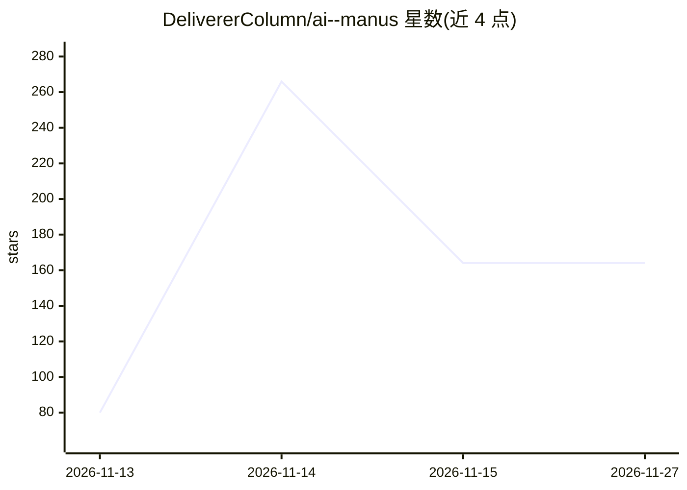

# DelivererColumn/ai--manus

⭐ 164 · Apache-2.0 · 推送 2026-11-15 · [GitHub](https://github.com/DelivererColumn/ai--manus) · 个人维护

**面向个人用户的自主 AI Agent：代跑代码与操控浏览器**

按 README 描述，Manus 是一个自主 AI Agent：代替用户编写并执行脚本、打开网页、与页面元素交互、执行多步骤任务，定位为家庭、学习与轻量办公场景的个人助手，非企业平台。支持任务模式的跨会话记忆，脚本与浏览器动作可在同一流程中衔接。README 给出兼容性表（最低双核 CPU、4 GB 内存）与六步上手流程，但未提供具体的安装命令、下载渠道细节或技术实现说明，代码执行描述为在沙盒环境（仓库描述）中进行。

## 筛选速览

| 维度 | 判定 | 备注 |
|---|---|---|
| AI 角色 | `ai-native` | 本体是模型或模型工具 |
| 许可风险 | `permissive` | Apache-2.0 |
| 部署形态 | `None` |  |
| 模型依赖 | — | README 未给出锁定关系 |
| 硬件要求 | — | 无带数字的原话,不猜 |
| 安装摩擦 | `low` | 无编译、无系统依赖或容器化 |
| 成熟度 | — | 结构信号不足 |

## 能力要点

- 自主编写并执行代码完成任务
- 浏览器控制：导航网页、填表、采集信息
- 代码与浏览器动作可在同一任务流程中衔接
- 面向学习、家庭与轻量办公的小规模任务

## 适用场景

- 让代理替我跑小脚本和快速实验
- 自动浏览多个网页收集资料并整理摘要
- 把重复性小任务委托给后台代理处理

## 场景标签

`AI 助手` `浏览器自动化` · 领域:效率与自动化

## 证据(README 行号)

> L18: Manus is an autonomous AI agent designed to run code and control a browser on your behalf. Instead of acting like a
> L22: Manus is not a heavy studio suite or a complex enterprise platform. It is a focused helper built for home, study, a

## 星数曲线

2026-11-13 80 → 2026-11-27 164（+84）

---
*卡片 v1 · prompt 1.4 · 生成 2026-11-17 · 置信度 low · 依据 README sha `0f78ee3a5dd2` · [字段定义](../../DATASET.md)*
