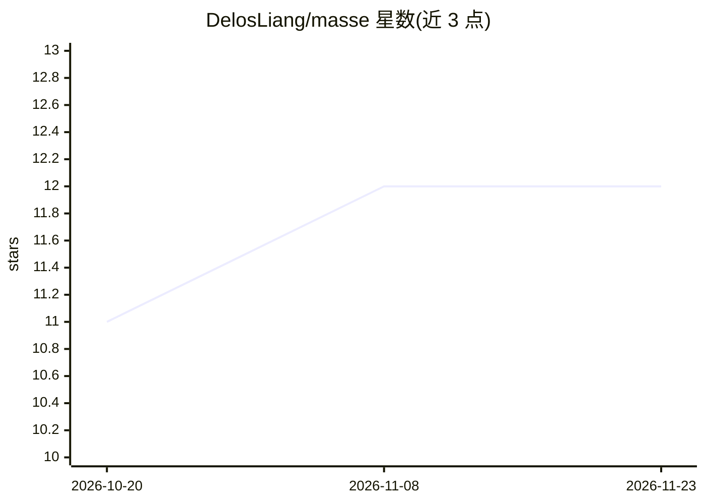

# DelosLiang/masse

⭐ 12 · Python · 推送 2025-12-15 · [GitHub](https://github.com/DelosLiang/masse) · [官网](https://arxiv.org/abs/2510.11004) · 个人维护

**给结构工程师：LLM 多智能体自动化规范解读与验算流程**

MASSE 是面向结构工程的多智能体系统，在模拟咨询机构环境中组织 Analyst、Engineer、Management 三个智能体团队，分工完成数据提取、荷载确定、结构建模、承载力验算与安全结论输出；内置 Structural Memory 存储分析数据，集成 FEM 求解器与工程文档工具，基于 AutoGen 构建，默认使用 GPT-4o，提供 Python API 与图形界面。README 声明仅限研究与教学用途，不可用于真实工程设计。

## 筛选速览

| 维度 | 判定 | 备注 |
|---|---|---|
| AI 角色 | `ai-native` | 本体是模型或模型工具 |
| 许可风险 | `none` | — |
| 部署形态 | `library` | 以包/库形式分发 |
| 模型依赖 | — | README 未给出锁定关系 |
| 硬件要求 | — | 无带数字的原话,不猜 |
| 安装摩擦 | `low` | 无编译、无系统依赖或容器化 |
| 成熟度 | `idea` | |

## 能力要点

- 三个智能体团队（分析/工程/管理）协作完成结构分析全流程
- 集成 LLM、FEM 求解器与工程文档四层工具
- 提供图形界面，支持问题数据集加载与几何可视化
- LLM 提供方可配置，默认 GPT-4o，可切换 Anthropic 模型

## 适用场景

- 结构工程问题的规范解读、荷载分析与承载力验算教学演示
- 多智能体协作在工程领域的案例研究
- 以图形界面批量运行结构分析问题数据集

## 场景标签

`多智能体` · 领域:Agent 开发

## 证据(README 行号)

> L7: **MASSE** is the first **M**ulti-**A**gent **S**ystem for **S**tructural **E**ngineering, integrating LLM-based agen
> L85: The `MASSE` system is built with `AutoGen` for flexibility and modularity. The framework uses `gpt-4o` as the defau
> L89: You can use `MASSE` within your Python code by importing the `masseagents` module and initializing a `StructuralAna

## 星数曲线

2026-10-20 11 → 2026-11-23 12（+1）

---
*卡片 v1 · prompt 1.4 · 生成 2026-11-18 · 置信度 high · 依据 README sha `d8cda3359efe` · [字段定义](../../DATASET.md)*
