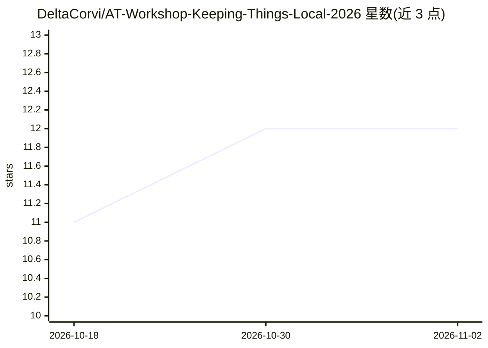

# DeltaCorvi/AT-Workshop-Keeping-Things-Local-2026

⭐ 12 · NOASSERTION · 推送 2026-08-19 · [GitHub](https://github.com/DeltaCorvi/AT-Workshop-Keeping-Things-Local-2026) · 个人维护

**四小时实操工坊手册：搭建带认证的私有本地 LLM 服务**

面向安全从业者、系统管理员和受合规约束行业人员的实验手册（CC BY 4.0），以 Obsidian vault 形式提供 11 个顺序模块。教学内容：在单 VM 上安装配置 Ollama 并管理本地模型、用 Modelfile 定制模型、用 Tailscale/Headscale 搭建加密 mesh 网络、用 nginx 反向代理加基本认证控制访问，最终通过 curl 与 Open WebUI 使用受保护模型并检视访问日志。两个实验 VM 与预装模型因体积单独分发，本地运行需 24 GB 内存以上。

## 筛选速览

| 维度 | 判定 | 备注 |
|---|---|---|
| AI 角色 | `ai-knowledge` | 知识聚合/清单类 |
| 许可风险 | `none` | NOASSERTION |
| 部署形态 | `None` |  |
| 模型依赖 | — | README 未给出锁定关系 |
| 硬件要求 | — | 无带数字的原话,不猜 |
| 安装摩擦 | `low` | 无编译、无系统依赖或容器化 |
| 成熟度 | — | 结构信号不足 |

## 能力要点

- 11 个顺序模块覆盖 Ollama 部署、Modelfile 定制、mesh 组网、nginx 认证
- 可选模块用 Headscale 自托管 mesh 控制平面
- 以 Obsidian vault 形式提供实验手册（含 callout 与检查点）
- 实验 VM 与预装模型单独分发以降低课堂带宽需求

## 适用场景

- 安全团队搭建不外泄客户数据的私有 AI 服务
- 红队/渗透测试人员在项目内使用本地 LLM 与 mesh 网络
- 受监管行业按数据主权要求自建团队可访问的模型服务

## 场景标签

`教程课程` · 领域:学习与行业

## 证据(README 行号)

> L1: # Keeping Things Local: Build It, Mesh It, Lock It
> L3: **A hands-on workshop for building a private, team-accessible AI service on hardware you control.**
> L13: This four-hour, hands-on workshop shows you how to build a working alternative: a private AI service running in an 

## 星数曲线

2026-10-18 11 → 2026-11-02 12（+1）

---
*卡片 v1 · prompt 1.4 · 生成 2026-11-01 · 置信度 high · 依据 README sha `e7c1f7533208` · [字段定义](../../DATASET.md)*
