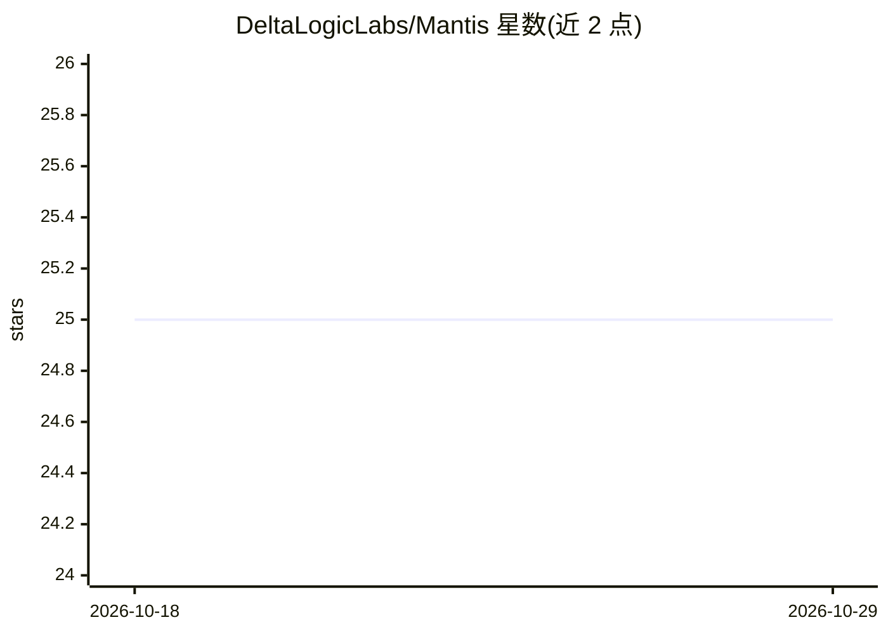

# DeltaLogicLabs/Mantis

⭐ 25 · TypeScript · MIT · 推送 2026-06-22 · [GitHub](https://github.com/DeltaLogicLabs/Mantis) · 组织维护

**自动管理 Meteora DLMM 流动性的 Claude 驱动代理**

运行于 Bun 1.2 的自主流动性代理：每 10 分钟扫描监视列表中的 Solana Meteora DLMM 池，经 Claude Agent SDK 推理后输出 HOLD/REBALANCE/EXIT/ENTER 决策，默认纸面交易，可切换链上执行。机制包括 Chroma 向量记忆（余弦相似度+30 天新近度加权检索）、成交量真实性评分（低于 0.70 跳过）、基于 bin step 数学的不完备损失估计，以及 6-7 道风险闸门（置信度、回撤、仓位上限等）拦截链上动作。通过 git clone + bun 安装，docker-compose 启动 Chroma，另含历史回测命令。

## 筛选速览

| 维度 | 判定 | 备注 |
|---|---|---|
| AI 角色 | `ai-native` | 本体是模型或模型工具 |
| 许可风险 | `permissive` | MIT |
| 部署形态 | `self-host` | docker 或自建部署 |
| 模型依赖 | locked-api |  |
| 硬件要求 | — | 无带数字的原话,不猜 |
| 安装摩擦 | `low` | 无编译、无系统依赖或容器化 |
| 成熟度 | — | 结构信号不足 |

## 能力要点

- recall→observe→reason→simulate→record→decide 六步决策循环，每 10 分钟执行
- ChromaDB 记忆库：余弦相似度检索、近重复合并、90/60 天过期与新近度加权
- 成交量真实性 0-1 评分过滤疑似刷量池（阈值 0.70）
- 基于 DLMM bin step 的 IL 估计与七道风险闸门拦截链上动作

## 适用场景

- 自动值守 Meteora DLMM 流动性仓位，价格漂移时再平衡或撤离
- 以纸面交易模式验证代理策略后再切换链上执行
- 通过回测命令在历史数据上模拟策略表现

## 场景标签

`金融量化` · 领域:学习与行业

## 证据(README 行号)

> L25: `mantis` fixes this with a Claude-powered agent that runs every 10 minutes, checks every pool in your watchlist, an
> L139: - **Agent**: Claude Agent SDK (`stop_reason === "tool_use"` loop)

## 星数曲线

2026-10-18 25 → 2026-10-29 25（+0）

---
*卡片 v1 · prompt 1.4 · 生成 2026-10-27 · 置信度 mid · 依据 README sha `27b843dd10a9` · [字段定义](../../DATASET.md)*
