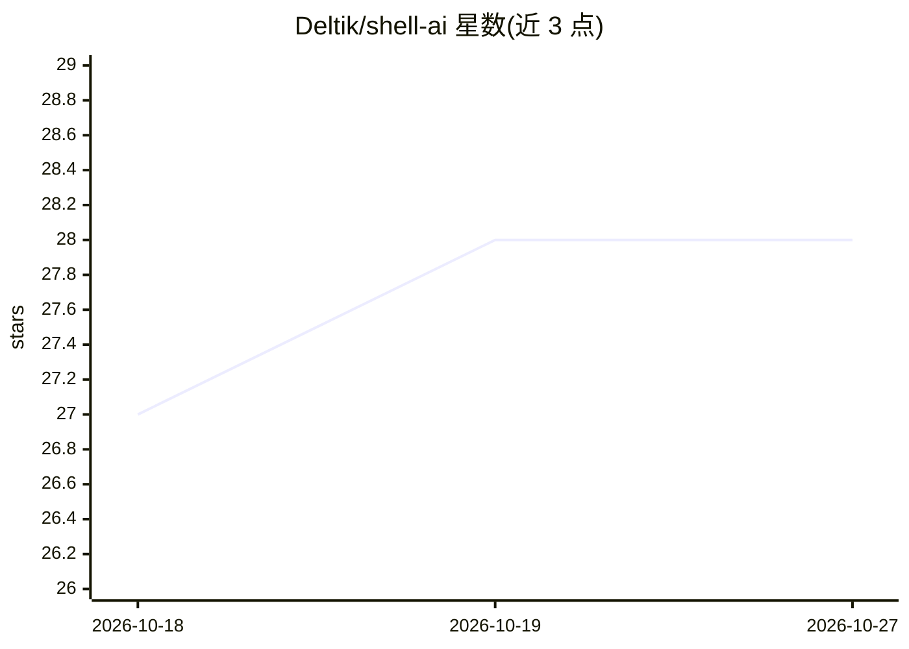

# Deltik/shell-ai

⭐ 28 · Rust · MIT · 推送 2026-06-11 · [GitHub](https://github.com/Deltik/shell-ai) · [官网](https://crates.io/crates/shell-ai) · 个人维护

**自然语言生成并解释 shell 命令的 Rust CLI**

用 Rust 编写的单二进制命令行工具：`suggest` 将任意语言描述的任务转为可执行 shell 命令，`explain` 将命令拆解为可理解的部分并引用 man 页面。支持 OpenAI、Groq、Ollama、Mistral、Azure OpenAI、Anthropic、Claude Code CLI、OpenAI Codex CLI 等多种 provider，配置可经 TOML 文件、环境变量或 CLI 参数加载并分层覆盖。提供交互式选择、流式预览、JSON 输出等脚本化能力。通过 cargo install、GitHub 预编译二进制或源码安装。

## 筛选速览

| 维度 | 判定 | 备注 |
|---|---|---|
| AI 角色 | `ai-native` | 本体是模型或模型工具 |
| 许可风险 | `permissive` | MIT |
| 部署形态 | `desktop` | 安装包/桌面程序 |
| 模型依赖 | local-ok | 支持本地模型 |
| 硬件要求 | — | 无带数字的原话,不猜 |
| 安装摩擦 | `low` | 无编译、无系统依赖或容器化 |
| 成熟度 | — | 结构信号不足 |

## 能力要点

- 自然语言转 shell 命令，支持任意语言输入
- explain 子命令拆解命令并引用 man 页面
- 多种 provider：OpenAI/Groq/Ollama/Mistral/Azure/Anthropic/Claude Code/Codex CLI
- 单二进制、无运行时依赖，支持 JSON 输出与非交互模式

## 适用场景

- 记不住命令语法时用自然语言生成正确的 shell 命令
- 理解陌生脚本或他人命令的含义
- 在自动化脚本中以 JSON 格式调用命令解释

## 场景标签

`代码生成` · 领域:编码与开发

## 证据(README 行号)

> L15: **Suggest** (**`shell-ai suggest`** or **`shai`**) turns natural language into executable shell commands. Describe 
> L17: **Explain** (**`shell-ai explain`**) breaks down shell commands into understandable parts, citing relevant man page
> L62: - **Multiple providers:** OpenAI, Azure OpenAI, Anthropic, Claude Code CLI, OpenAI Codex CLI – plus OpenAI-compatib

## 星数曲线

2026-10-18 27 → 2026-10-27 28（+1）

---
*卡片 v1 · prompt 1.4 · 生成 2026-10-26 · 置信度 mid · 依据 README sha `9349828849d5` · [字段定义](../../DATASET.md)*
