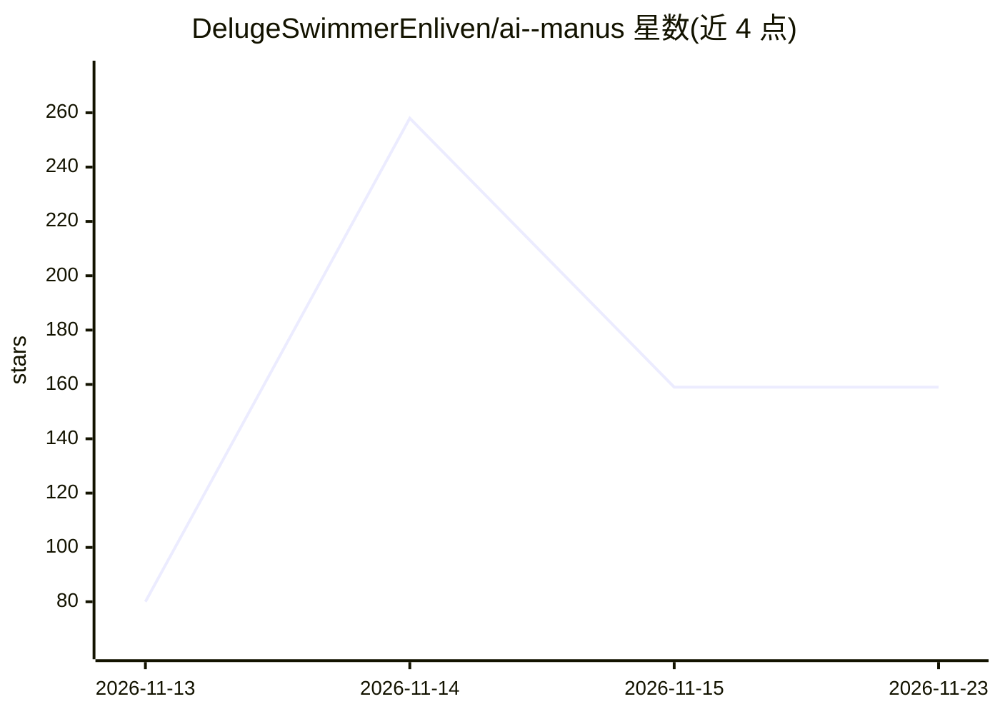

# DelugeSwimmerEnliven/ai--manus

⭐ 159 · Apache-2.0 · 推送 2026-11-15 · [GitHub](https://github.com/DelugeSwimmerEnliven/ai--manus) · 个人维护

**面向个人用户的自主 AI Agent：代跑代码与操控浏览器**

README 描述 Manus 为自主 AI 代理，可在最少监督下编写并执行脚本、打开网页、与页面元素交互并完成多步任务，定位为学习、家庭与轻量工作的个人助手，而非企业平台。核心机制为代码执行与浏览器控制结合的流程。README 为宣传性介绍，未给出安装命令、源码结构或技术实现细节，仅列出系统兼容性表（最低 4GB 内存、双核 CPU）。

## 筛选速览

| 维度 | 判定 | 备注 |
|---|---|---|
| AI 角色 | `ai-native` | 本体是模型或模型工具 |
| 许可风险 | `permissive` | Apache-2.0 |
| 部署形态 | `None` |  |
| 模型依赖 | — | README 未给出锁定关系 |
| 硬件要求 | — | 无带数字的原话,不猜 |
| 安装摩擦 | `low` | 无编译、无系统依赖或容器化 |
| 成熟度 | — | 结构信号不足 |

## 能力要点

- 自主编写并执行代码完成多步任务
- 浏览器控制：导航网页、填表、采集信息
- 代码与浏览器动作在同一流程中衔接
- 面向学习、家庭与轻量办公的小规模场景

## 适用场景

- 让代理代为查网页、填表、收集资料
- 自动跑小脚本和组织研究笔记
- 把重复的日常小任务交给后台代理处理

## 场景标签

`AI 助手` `编码 Agent` `浏览器自动化` · 领域:效率与自动化

## 证据(README 行号)

> L18: Manus is an autonomous AI agent designed to run code and control a browser on your behalf. Instead of acting like a
> L10: - **Autonomous Code Execution:** Manus AI agent runs code on its own to complete tasks, so you can focus on decisio

## 星数曲线

2026-11-13 80 → 2026-11-23 159（+79）

---
*卡片 v1 · prompt 1.4 · 生成 2026-11-17 · 置信度 mid · 依据 README sha `0f78ee3a5dd2` · [字段定义](../../DATASET.md)*
