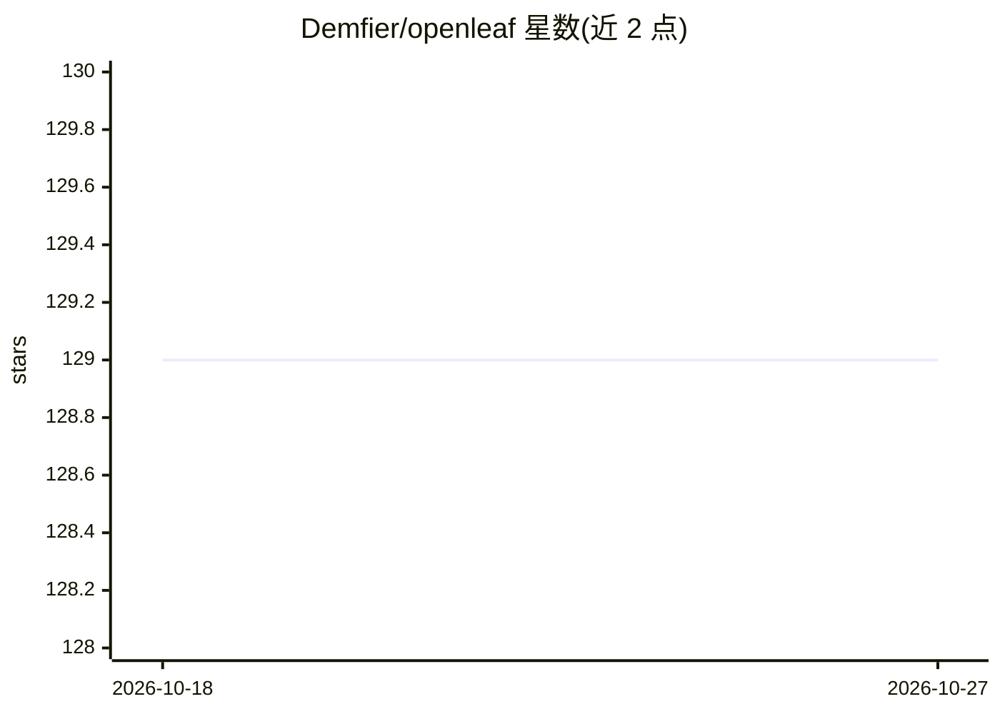

# Demfier/openleaf

⭐ 129 · TypeScript · 推送 2026-06-13 · [GitHub](https://github.com/Demfier/openleaf) · [官网](https://chromewebstore.google.com/detail/openleaf-citation-search/jjcmeicpmfcimamdmchabfpjcljieafk) · 个人维护

**面向 Overleaf 的 AI 引文检索与论文评审浏览器扩展**

Manifest V3 浏览器扩展，嵌入 overleaf.com 编辑器：Citations 标签逐段检索相关论文并用 LLM 打 0-100 分附推理理由，可一键将 BibTeX 条目追加到 .bib 文件；Review 标签提供 Friendly（建设性）与 Fire（Reviewer #2）两种 AI 评审模式。LLM 后端兼容任何 OpenAI 风格 API，默认指向本地 Ollama，也支持 vLLM/OpenAI/OpenRouter/Groq 等；论文检索用 Semantic Scholar、Serper、OpenAlex。单一 Chromium 构建覆盖 Chrome/Opera/Edge，Safari 需 macOS 上用 Xcode 转换构建。不收集数据。

## 筛选速览

| 维度 | 判定 | 备注 |
|---|---|---|
| AI 角色 | `ai-native` | 本体是模型或模型工具 |
| 许可风险 | `none` | — |
| 部署形态 | `desktop` | 安装包/桌面程序 |
| 模型依赖 | local-ok | 支持本地模型 |
| 硬件要求 | — | 无带数字的原话,不猜 |
| 安装摩擦 | `low` | 无编译、无系统依赖或容器化 |
| 成熟度 | — | 结构信号不足 |

## 能力要点

- 逐段引文检索，LLM 打分 0-100 并附推理理由
- 一键追加 BibTeX 条目到 .bib 文件
- 两种 AI 评审模式（Friendly / Fire）
- LLM 后端兼容任意 OpenAI 风格 API，默认本地 Ollama

## 适用场景

- 在 Overleaf 写作时直接查找并插入相关引文
- 投稿前获取 AI 生成的论文评审反馈
- 在浏览器内配置本地或远程 LLM 后端进行文献排序

## 场景标签

`科研工具` · 领域:学习与行业

## 证据(README 行号)

> L4:  AI-powered citation search & paper review for Overleaf
> L13: 3. **Citations tab** — click "Find Citations" to discover papers paragraph by paragraph, scored 0-100 with LLM reas
> L14: 4. **Review tab** — get AI feedback on your paper in Friendly (constructive) or Fire (Reviewer #2) mode

## 星数曲线

2026-10-18 129 → 2026-10-27 129（+0）

---
*卡片 v1 · prompt 1.4 · 生成 2026-10-23 · 置信度 high · 依据 README sha `1e7921e5ef11` · [字段定义](../../DATASET.md)*
