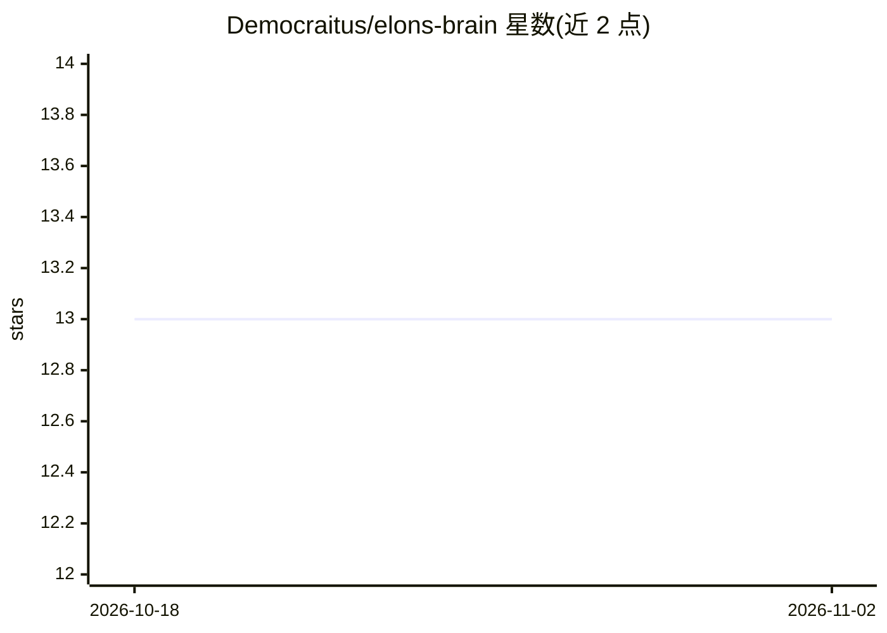

# Democraitus/elons-brain

⭐ 13 · Python · NOASSERTION · 推送 2026-05-30 · [GitHub](https://github.com/Democraitus/elons-brain) · 个人维护

**以 Elon Musk 思维方式回答决策问题的 Claude Code 技能包**

基于《The Book of Elon》（Eric Jorgenson, Scribe Media, 2026）构建的 Claude Code 技能集，包含 401 页全书文本与 72 个思维模型（约 380 条直接引语）。提供两种产物：单一 brain 技能，在决策类问题（创始人、工程、产品、招聘、策略、风险）触发并以 Elon 风格带引语回答；以及 72 个可独立触发的扁平技能包。每个技能含 SKILL.md 与触发测试 evals，stacks_with 字段声明技能共触发关系。需 Claude Code 环境运行。

## 筛选速览

| 维度 | 判定 | 备注 |
|---|---|---|
| AI 角色 | `ai-ecosystem` | LLM/agent 周边工具 |
| 许可风险 | `none` | NOASSERTION |
| 部署形态 | `desktop` | 安装包/桌面程序 |
| 模型依赖 | — | README 未给出锁定关系 |
| 硬件要求 | — | 无带数字的原话,不猜 |
| 安装摩擦 | `low` | 无编译、无系统依赖或容器化 |
| 成熟度 | — | 结构信号不足 |

## 能力要点

- 内嵌 401 页全书语料与 72 个思维模型（约 380 条验证引语）
- brain 单技能在决策类问题上触发并带原文引语回答
- 72 个技能可独立安装，stacks_with 声明技能组合关系
- 每个技能附 2-3 个触发测试（evals.json）

## 适用场景

- 在 Claude Code 中以 Elon 的思维方式获取决策问题回答
- 在代码评审、招聘、设计审查等场景调用特定思维模型
- 研究思维模型类 agent 技能的结构与组织方式

## 场景标签

 · 领域:AI 技能/知识封装

## 证据(README 行号)

> L9: A single Claude Code skill that fires on any decision question (founder, engineering, product, hiring, strategy, sch
> L22: cp -R elon ~/.claude/skills/
> L34: ### 2. The pack — 72 individual Claude Code skills

## 星数曲线

2026-10-18 13 → 2026-11-02 13（+0）

---
*卡片 v1 · prompt 1.4 · 生成 2026-10-31 · 置信度 high · 依据 README sha `bb19270ac736` · [字段定义](../../DATASET.md)*
