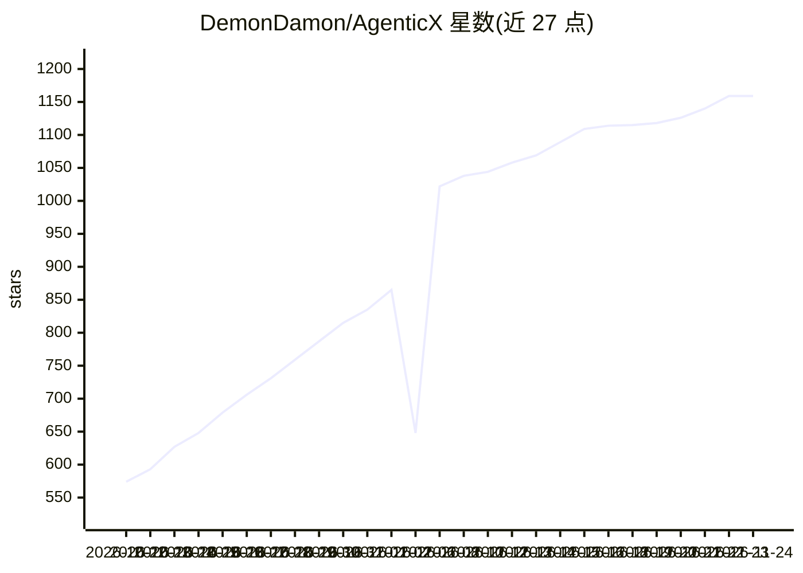

# DemonDamon/AgenticX

⭐ 1,159 · Python · Apache-2.0 · 推送 2026-11-22 · [GitHub](https://github.com/DemonDamon/AgenticX) · [官网](https://www.agxbuilder.com/) · 组织维护 · 中文 README

**给开发者的统一多智能体平台：SDK+CLI+桌面端+企业版**

提供 Python SDK、agx CLI、Studio Server（FastAPI REST+SSE）与 Electron 桌面工作台 Near Desktop，并另有面向企业的 Web Portal 与 Go AI Gateway。核心机制包括：Meta-Agent 调度、可嵌入 ReActAgent 原语、MCP Hub、分层记忆（含 Mem0 集成）、GraphRAG 知识库、技能自演化、安全沙箱（Docker/Microsandbox/Subprocess 后端）与评测监控框架。LLM 接入 15+ 供应商，支持响应缓存与故障转移。核心包约 27 个轻量依赖，torch/pandas 为可选 extras。

## 筛选速览

| 维度 | 判定 | 备注 |
|---|---|---|
| AI 角色 | `ai-ecosystem` | LLM/agent 周边工具 |
| 许可风险 | `permissive` | Apache-2.0 |
| 部署形态 | `library` | 以包/库形式分发 |
| 模型依赖 | local-ok | 支持本地模型 |
| 硬件要求 | — | 无带数字的原话,不猜 |
| 安装摩擦 | `low` | 无编译、无系统依赖或容器化 |
| 成熟度 | — | 结构信号不足 |

## 能力要点

- Python SDK + agx CLI + Studio Server + Electron 桌面端的多形态产品架构
- 15+ LLM 供应商接入，含响应缓存与 failover 路由
- MCP Hub 多服务器聚合与沙箱内 MCP gateway
- 技能自演化：运行时捕获工具调用并自动蒸馏新技能，含质量门与生命周期管理

## 适用场景

- 用 Python SDK 构建多智能体编排工作流
- 在本地桌面端以多窗格方式运行多 agent 会话
- 企业内部署带治理、配额与审计的 AI 网关
- 管理知识库（GraphRAG/混合检索）并接入 Feishu/微信 IM

## 场景标签

`Agent 框架` `多智能体` `RAG` `知识图谱` · 领域:Agent 开发

## 证据(README 行号)

> L20: **AgenticX** provides a unified, scalable, production-ready agent technology stack. Developers can build directly w
> L26: - **AgenticX Core / Runtime**: Python SDK, Studio Server, and Agent Runtime for orchestration, tools, MCP, memory, 
> L43: - **LLM Providers**: 15+ providers — OpenAI, Anthropic, Ollama, Gemini, Kimi/Moonshot, MiniMax, Ark/VolcEngine, Zhi

## 星数曲线

2026-10-22 574 → 2026-11-24 1,159（+585）

---
*卡片 v1 · prompt 1.4 · 生成 2026-11-24 · 置信度 high · 依据 README sha `eb9fa0a2cf8a` · [字段定义](../../DATASET.md)*
