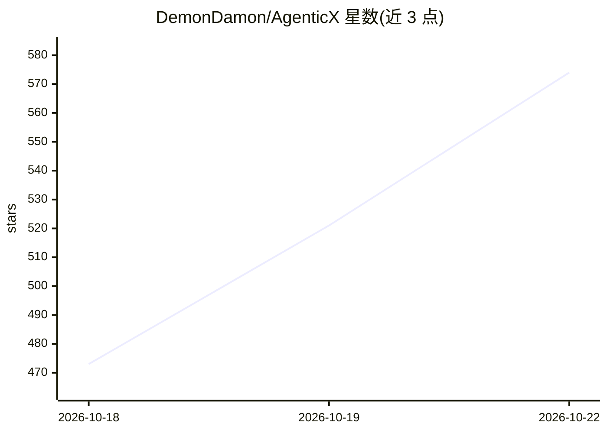

# DemonDamon/AgenticX

⭐ 593 · Python · Apache-2.0 · 推送 2026-10-22 · [GitHub](https://github.com/DemonDamon/AgenticX) · [官网](https://www.agxbuilder.com/) · 个人维护 · 中文 README

**统一多智能体平台：Python SDK + CLI + Studio + 桌面工作台**

提供共享能力核心与两种产品形态：Python SDK、agx CLI 和 FastAPI Studio Server 构成的 Agent 运行时，支持 Meta-Agent 调度、图编排、MCP Hub、分层记忆、GraphRAG 知识库、技能生态、Docker/子进程沙箱、评测与可观测性；Near Desktop 为 Electron+React 本地优先多智能体工作台（多窗格聊天、头像群聊、嵌入式终端）；另有企业版 Web Portal 与 Go AI Gateway。支持 15+ LLM 提供商。企业集群运行时未启动，沙箱安全层未覆盖全部路径。

## 筛选速览

| 维度 | 判定 | 备注 |
|---|---|---|
| AI 角色 | `ai-ecosystem` | LLM/agent 周边工具 |
| 许可风险 | `permissive` | Apache-2.0 |
| 部署形态 | `library` | 以包/库形式分发 |
| 模型依赖 | local-ok | 支持本地模型 |
| 硬件要求 | — | 无带数字的原话,不猜 |
| 安装摩擦 | `low` | 无编译、无系统依赖或容器化 |
| 成熟度 | — | 结构信号不足 |

## 能力要点

- Meta-Agent CEO 调度 + 图编排工作流引擎
- MCP Hub、分层记忆与 GraphRAG 知识库
- 技能自演化：运行时捕获工具调用并蒸馏新技能
- Electron 本地优先桌面工作台 + 企业 Go AI Gateway

## 适用场景

- 用 Python SDK / CLI 构建多智能体工作流应用
- 在本地桌面工作台与多智能体头像群聊协作
- 企业内部部署 AI 网关做策略、配额与审计

## 场景标签

`Agent 框架` `多智能体` `RAG` `模型网关` · 领域:Agent 开发

## 证据(README 行号)

> L26: - **AgenticX Core / Runtime**: Python SDK, Studio Server, and Agent Runtime for orchestration, tools, MCP, memory, 
> L43: - **LLM Providers**: 15+ providers — OpenAI, Anthropic, Ollama, Gemini, Kimi/Moonshot, MiniMax, Ark/VolcEngine, Zhi

## 星数曲线

2026-10-18 473 → 2026-10-22 574（+101）

---
*卡片 v1 · prompt 1.4 · 生成 2026-10-21 · 置信度 high · 依据 README sha `9471baecf503` · [字段定义](../../DATASET.md)*
