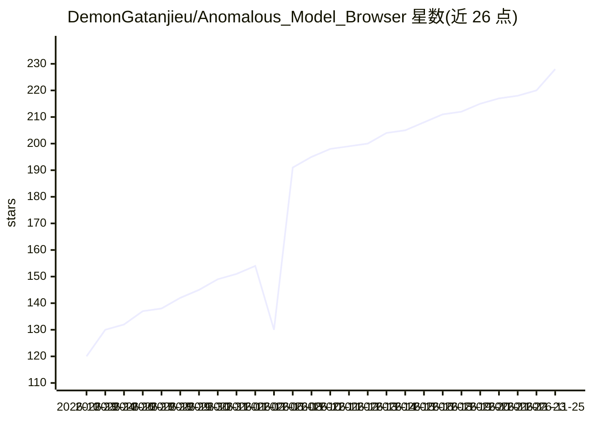

# DemonGatanjieu/Anomalous_Model_Browser

⭐ 228 · JavaScript · MIT · 推送 2026-11-23 · [GitHub](https://github.com/DemonGatanjieu/Anomalous_Model_Browser) · 个人维护 · 中文 README

**ComfyUI 本地资产伴侣：模型管理、修缺与 MCP AI 工作台**

以 ComfyUI 扩展形式安装（零自定义节点）的本地伴侣工具：按 SHA-256 哈希在 Civitai 匹配模型、识别 .safetensors/.gguf 头部判断模型类型与基础模型、拖拽归类模型文件、一键修复丢失/改名/移动的模型节点，并支持图库检索、画布存档、批量任务与提示词标签编辑。可选的 MCP AI 工作台允许 Claude、Cursor 等 MCP 应用在副本画布上操作工作流，每步可追溯、可撤销，并提供隐私模式将提示词与图像保留在本地。

## 筛选速览

| 维度 | 判定 | 备注 |
|---|---|---|
| AI 角色 | `ai-enhanced` | 去掉 AI 部分产品仍成立 |
| 许可风险 | `permissive` | MIT |
| 部署形态 | `None` |  |
| 模型依赖 | — | README 未给出锁定关系 |
| 硬件要求 | — | 无带数字的原话,不猜 |
| 安装摩擦 | `low` | 无编译、无系统依赖或容器化 |
| 成熟度 | — | 结构信号不足 |

## 能力要点

- 按 SHA-256 指纹在 Civitai 匹配模型并哈希校验下载，一键修复缺失模型
- 读取 .safetensors/.gguf 文件头离线识别 25+ 架构，不执行 pickle 代码
- MCP AI 工作台在副本画布运行、全操作日志与一键撤销，支持隐私模式
- 零自定义节点、插件自身不加载模型、零显存占用

## 适用场景

- 把下载目录里命名混乱的模型自动归入 ComfyUI 正确文件夹
- 打开他人分享的工作流时按指纹找回或重装缺失模型
- 按提示词/模型哈希检索历史出图并还原工作流
- 让 Claude/Cursor 等 MCP 应用在副本上代为调整 ComfyUI 工作流

## 场景标签

 · 领域:AI 绘图工具链/资产管管

## 证据(README 行号)

> L4: *A 100% local companion for ComfyUI's everyday chores — zero custom nodes, zero VRAM.*
> L26: - **Zero custom nodes.** The canvas and nodes stay 100% standard ComfyUI (or node packs you already installed), so 
> L57: Want a cloud LLM (Claude, Cursor, Antigravity, or other MCP apps) to help wire, organize, and explore ComfyUI route

## 星数曲线

2026-10-23 120 → 2026-11-25 228（+108）

---
*卡片 v1 · prompt 1.4 · 生成 2026-11-25 · 置信度 high · 依据 README sha `edc990ca2e9b` · [字段定义](../../DATASET.md)*
