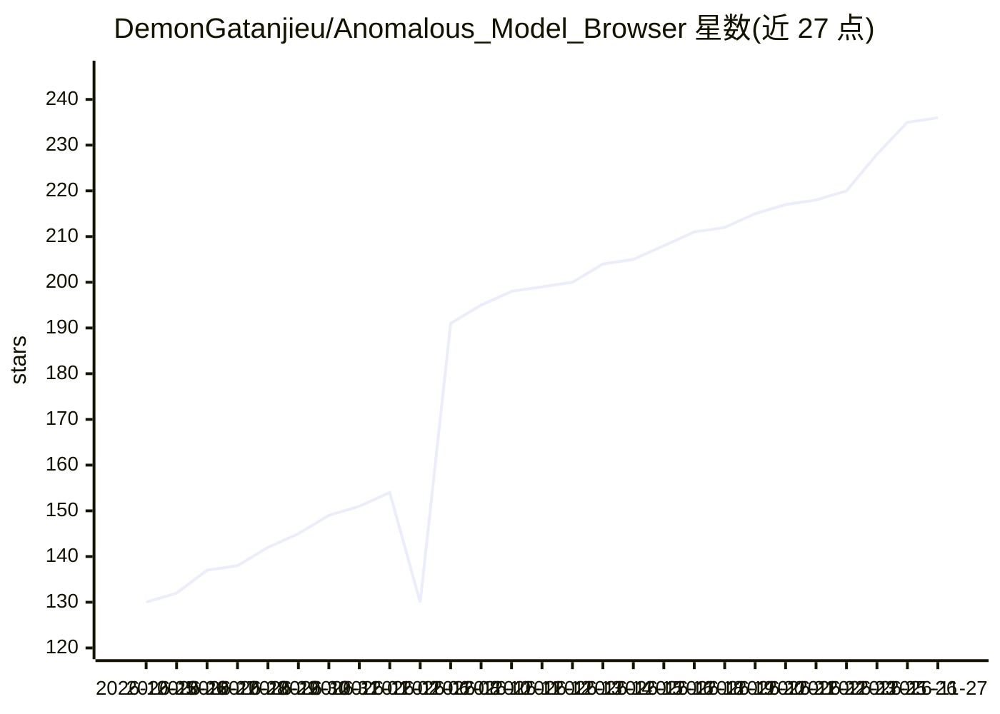

# DemonGatanjieu/Anomalous_Model_Browser

⭐ 236 · JavaScript · MIT · 推送 2026-11-26 · [GitHub](https://github.com/DemonGatanjieu/Anomalous_Model_Browser) · 个人维护 · 中文 README

**ComfyUI 零自定义节点本地伴侣：管模型、修缺失、存画布、接 MCP**

作为 ComfyUI 的本地伴生工具，提供模型库管理（读取 .safetensors/.gguf 文件头识别类型与基座模型）、按 SHA-256 哈希在 Civitai 匹配真实标题与封面、工作流缺失模型的一键指纹修复、图库按生成参数检索、画布存档与批量任务表等功能。可选 MCP AI Workbench 让外部 LLM 在副本画布上操作，全程留痕可撤销，并提供隐私模式。安装走 ComfyUI Manager 或 git clone 到 custom_nodes。

## 筛选速览

| 维度 | 判定 | 备注 |
|---|---|---|
| AI 角色 | `ai-ecosystem` | LLM/agent 周边工具 |
| 许可风险 | `permissive` | MIT |
| 部署形态 | `None` |  |
| 模型依赖 | — | README 未给出锁定关系 |
| 硬件要求 | — | 无带数字的原话,不猜 |
| 安装摩擦 | `low` | 无编译、无系统依赖或容器化 |
| 成熟度 | — | 结构信号不足 |

## 能力要点

- 读取 .safetensors/.gguf 文件头离线识别 25+ 模型架构，不执行 pickle 代码
- 按 SHA-256 指纹匹配/重装缺失模型，下载后哈希校验
- MCP AI Workbench 在副本画布操作，每步可撤销并提供隐私模式
- 画布存档支持固定种子批量对比，活动日志记录每次变更

## 适用场景

- 把下载的模型文件拖入即自动归位到正确目录
- 打开他人分享的工作流时一键修复缺失模型节点
- 按提示词或模型哈希检索历史出图并还原工作流
- 让外部 AI 在副本上代为搭建与调整 ComfyUI 流程

## 场景标签

 · 领域:AI 绘图工具链/资产管理

## 证据(README 行号)

> L4: *A 100% local companion for ComfyUI's everyday chores — zero custom nodes, zero VRAM.*
> L26: - **Zero custom nodes.** The canvas and nodes stay 100% standard ComfyUI (or node packs you already installed), so 
> L57: Want a cloud LLM (Claude, Cursor, Antigravity, or other MCP apps) to help wire, organize, and explore ComfyUI route

## 星数曲线

2026-10-25 130 → 2026-11-27 236（+106）

---
*卡片 v1 · prompt 1.4 · 生成 2026-11-27 · 置信度 mid · 依据 README sha `d0fd6ef9940e` · [字段定义](../../DATASET.md)*
