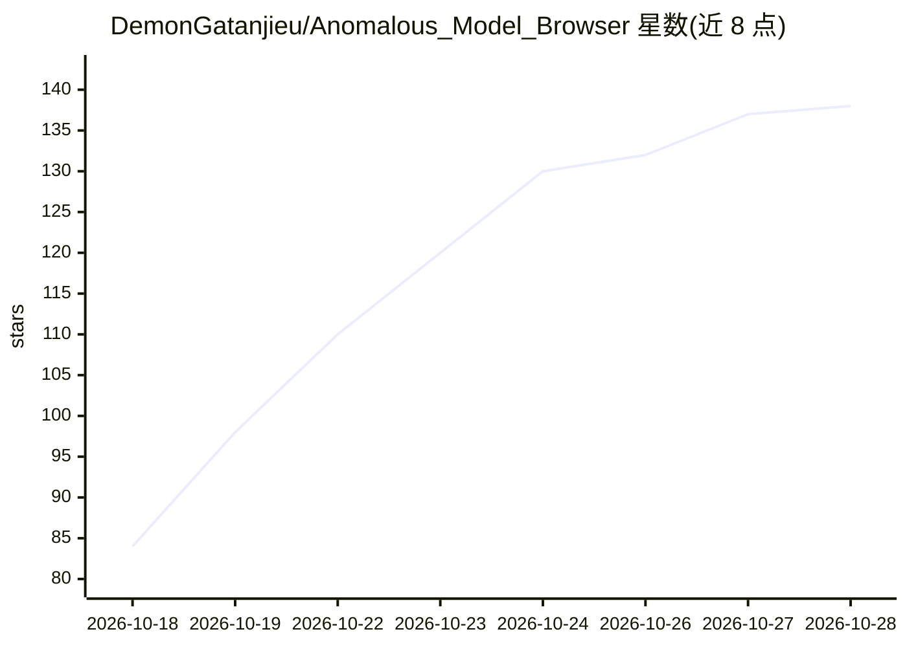

# DemonGatanjieu/Anomalous_Model_Browser

⭐ 142 · JavaScript · MIT · 推送 2026-10-28 · [GitHub](https://github.com/DemonGatanjieu/Anomalous_Model_Browser) · 个人维护 · 中文 README

**ComfyUI 插件：模型浏览、图库回溯、工作流与提示词管理**

运行在 ComfyUI 内的模型浏览器与创作工作台：按文件哈希从 Civitai 获取模型真名、封面、触发词与底模；Model Check 检查打开的工作流缺失哪些模型，按指纹找回或从 Civitai/Hugging Face 下载；图库可按提示词/模型/LoRA 搜索并拖回图片恢复工作流；支持工作流配方、模型搭配、提示词词块编辑（中文自动译英文）、操作记录与撤销。配合 Anomalous_TTS 节点包可为 GPT-SoVITS 角色配音。插件自身不加载模型，通过 ComfyUI Manager 安装或克隆到 custom_nodes。

## 筛选速览

| 维度 | 判定 | 备注 |
|---|---|---|
| AI 角色 | `ai-ecosystem` | LLM/agent 周边工具 |
| 许可风险 | `permissive` | MIT |
| 部署形态 | `None` |  |
| 模型依赖 | — | README 未给出锁定关系 |
| 硬件要求 | — | 无带数字的原话,不猜 |
| 安装摩擦 | `low` | 无编译、无系统依赖或容器化 |
| 成熟度 | — | 结构信号不足 |

## 能力要点

- 按文件哈希从 Civitai 匹配模型信息（名称/封面/触发词/底模）
- Model Check 按指纹一键找回工作流缺失模型
- 图库按提示词/模型/LoRA 搜索，拖图恢复工作流
- 搭配卡片、提示词词块编辑、操作记录与撤销

## 适用场景

- 管理越来越多的 Checkpoint 和 LoRA，看封面挑模型
- 打开别人的工作流缺模型时找回或下载
- 把调好的模型搭配和提示词存成卡片反复使用
- 回溯某张出图当时用的工作流

## 场景标签

`提示工程` · 领域:Agent 开发

## 证据(README 行号)

> L3: **A model browser and creative workspace for ComfyUI**
> L19: > **Anomalous Model Browser** takes care of the chores around ComfyUI in one window: browse your models with their 
> L59: 1. In **ComfyUI Manager**, search `Anomalous Model Browser`, install it and restart ComfyUI. Or clone it into `cust

## 星数曲线

2026-10-18 84 → 2026-10-28 138（+54）

---
*卡片 v1 · prompt 1.4 · 生成 2026-10-23 · 置信度 high · 依据 README sha `8ae5bb05f541` · [字段定义](../../DATASET.md)*
