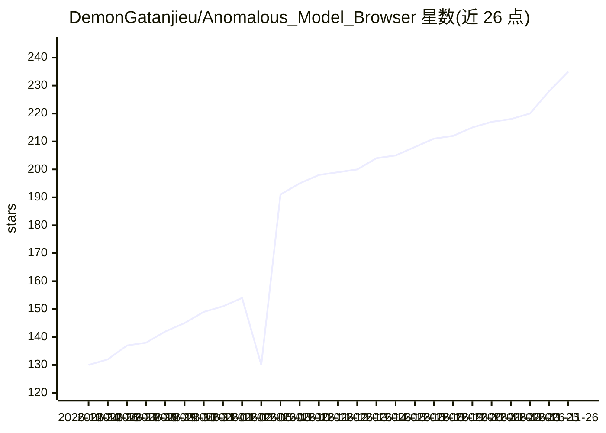

# DemonGatanjieu/Anomalous_Model_Browser

⭐ 235 · JavaScript · MIT · 推送 2026-11-25 · [GitHub](https://github.com/DemonGatanjieu/Anomalous_Model_Browser) · 个人维护 · 中文 README

**给 ComfyUI 用户的本地模型/工作流资产管理器，可选 MCP AI 辅助**

以 ComfyUI 扩展形式安装（零自定义节点、自称零显存占用），提供模型库管理：按 SHA-256 哈希在 Civitai 匹配封面、触发词与底模徽章，读取 .safetensors/.gguf 头部识别模型类型，并用指纹一键修复移动/改名后的缺失模型；附画廊检索、画布存档、批量任务表、节点组合复用与提示词标签编辑，所有变更记录在 Activity 并可一键撤销。可选接入外部 MCP AI 应用操作画布，支持副本运行、逐步撤销与隐私模式。

## 筛选速览

| 维度 | 判定 | 备注 |
|---|---|---|
| AI 角色 | `ai-enhanced` | 去掉 AI 部分产品仍成立 |
| 许可风险 | `permissive` | MIT |
| 部署形态 | `None` |  |
| 模型依赖 | local-ok | 支持本地模型 |
| 硬件要求 | — | 无带数字的原话,不猜 |
| 安装摩擦 | `low` | 无编译、无系统依赖或容器化 |
| 成熟度 | — | 结构信号不足 |

## 能力要点

- SHA-256 指纹匹配 Civitai 元数据并一键修复缺失模型
- 读取 .safetensors/.gguf 文件头识别模型类型与 25+ 新架构
- 画布存档、批量任务与提示词 Studio 等内置工具
- MCP AI 工作台：副本运行、全程撤销、隐私模式

## 适用场景

- 把下载散落的模型文件自动归位并配上封面和触发词
- 接手他人分享的工作流时按指纹找回缺失模型
- 在一张画布上保存多个版本并排对比出图效果
- 让外部 AI 应用代为接线整理 ComfyUI 流程

## 场景标签

`图像生成` · 领域:内容生成

## 证据(README 行号)

> L4: *A 100% local companion for ComfyUI's everyday chores — zero custom nodes, zero VRAM.*
> L55: ### 🤖 Optional: let your own AI help (with built-in ways & privacy mode)
> L63: 1. In **ComfyUI Manager**, search `Anomalous Model Browser`, install it and restart ComfyUI. Or clone it into `cust

## 星数曲线

2026-10-24 130 → 2026-11-26 235（+105）

---
*卡片 v1 · prompt 1.4 · 生成 2026-11-26 · 置信度 high · 依据 README sha `017f67ffb486` · [字段定义](../../DATASET.md)*
