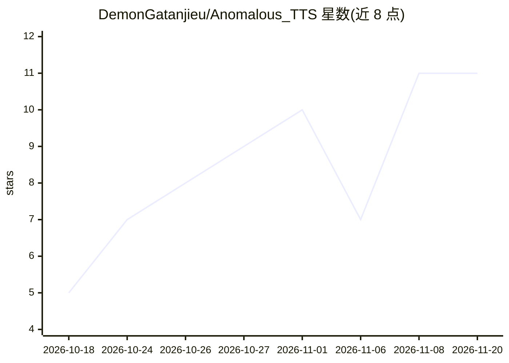

# DemonGatanjieu/Anomalous_TTS

⭐ 11 · Python · NOASSERTION · 推送 2026-10-28 · [GitHub](https://github.com/DemonGatanjieu/Anomalous_TTS) · 个人维护 · 中文 README

**ComfyUI 节点包：用训练好的 GPT-SoVITS 角色模型生成台词语音**

在 ComfyUI 中加载用户自备的 GPT-SoVITS 角色模型（v1–v4）生成语音：支持日语/中文/英语、情绪标签切换参考音频、多说话人、停顿与分段重新生成；推理代码精简后内置，无需另装 GPT-SoVITS 整合包，底模首次生成时自动下载（最多约 1.6 GB）。通过 ComfyUI Manager 或 git clone 安装，可与配套的 Anomalous Model Browser 协作管理角色与情绪标注，也可单独使用。

## 筛选速览

| 维度 | 判定 | 备注 |
|---|---|---|
| AI 角色 | `ai-native` | 本体是模型或模型工具 |
| 许可风险 | `none` | NOASSERTION |
| 部署形态 | `desktop` | 安装包/桌面程序 |
| 模型依赖 | — | README 未给出锁定关系 |
| 硬件要求 | — | 无带数字的原话,不猜 |
| 安装摩擦 | `low` | 无编译、无系统依赖或容器化 |
| 成熟度 | — | 结构信号不足 |

## 能力要点

- 台词内嵌情绪、换人、停顿、语速等标签语法，同一句可单独重生成
- 支持 v1/v2/v2Pro/Plus/v3/v4 模型，跨日语/中文/英语
- 每句自动统一音量，相同输入得到相同输出
- 提供 API 工作流调用示例与 AI 助手调参指南（docs/AGENT_GUIDE.md）

## 适用场景

- 在 ComfyUI 工作流里为视频/游戏角色批量生成配音台词
- 多人对话脚本按角色标签切换不同模型朗读
- 对读错的词配置读音替换表修正发音

## 场景标签

`语音合成` `语音 Agent` · 领域:对话与助手

## 证据(README 行号)

> L1: # Anomalous TTS (GPT-SoVITS)
> L3: 在 ComfyUI 里用训练好的 GPT-SoVITS 角色模型读台词：多句一起生成，可以切换情绪、多人对话、插入停顿。**不需要另外安装 GPT-SoVITS 整合包**：推理代码已经精简后放在节点包里，直接用 ComfyUI 的
> L29: 2. **添加节点** `角色语音 (GPT-SoVITS)`（英文界面叫 `Character Speech (GPT-SoVITS)`，分类 `Anomalous/TTS`），选角色，写台词，接 Save Audio 或 Pr

## 星数曲线

2026-10-18 5 → 2026-11-20 11（+6）

---
*卡片 v1 · prompt 1.4 · 生成 2026-11-19 · 置信度 high · 依据 README sha `1302c10e37c6` · [字段定义](../../DATASET.md)*
