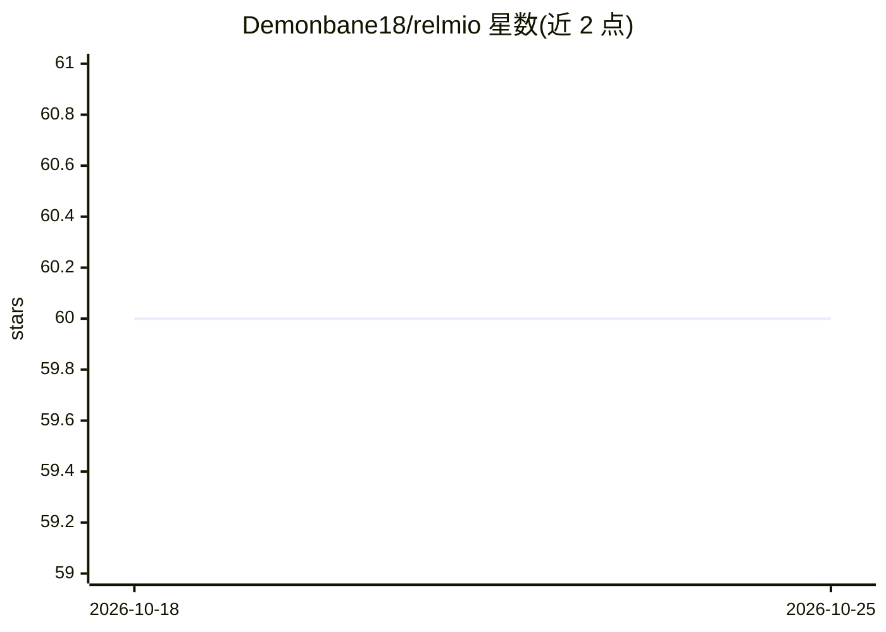

# Demonbane18/relmio

⭐ 60 · JavaScript · Apache-2.0 · 推送 2026-10-23 · [GitHub](https://github.com/Demonbane18/relmio) · [官网](https://relmio.jpfusin.tech/) · 个人维护

**本地浏览器向导：为自托管 n8n 安装 ChatGPT/SuperGrok 等 OAuth 接入**

Relmio 是运行在 127.0.0.1 的本地安装向导，为自托管 n8n 配置 ChatGPT 计划用量 OAuth sidecar、SuperGrok OAuth 伴随服务、本地模型（Ollama）等连接，并以 OpenAI 兼容端点形式供 n8n 的模型节点调用。提供 owner 作用域的回环仪表盘管理 8 类服务状态、托管方案规划器（15 个 Linux VM 预设与部署工件）及迁移/更新流程。身份、计划授权与模型访问分开校验，不导入个人 Codex 凭据或转换为平台 API key；VPS 远程令牌存储等合规问题保持开放。需 Node.js 24+，通过 npx/npm 或托管安装脚本运行。

## 筛选速览

| 维度 | 判定 | 备注 |
|---|---|---|
| AI 角色 | `ai-ecosystem` | LLM/agent 周边工具 |
| 许可风险 | `permissive` | Apache-2.0 |
| 部署形态 | `library` | 以包/库形式分发 |
| 模型依赖 | local-ok | 支持本地模型 |
| 硬件要求 | — | 无带数字的原话,不猜 |
| 安装摩擦 | `low` | 无编译、无系统依赖或容器化 |
| 成熟度 | `idea` | |

## 能力要点

- 为 n8n 提供 ChatGPT 计划用量、SuperGrok OAuth、本地 Ollama 三类 OpenAI 兼容端点
- 回环仪表盘管理 8 个服务（Codex App Server、Grok Build、n8n 栈等）并显示经验证的连接 URL
- 托管方案规划器生成 15 个 Linux VM 预设及部署工件，不接触提供商账户或远程主机
- 身份、计划权限与模型访问分离校验，不导入旧 Codex 凭据

## 适用场景

- 让自托管 n8n 用 ChatGPT 计划用量而非平台 API key 调用模型
- 在 n8n 工作流中接入 SuperGrok OAuth 或本地 Ollama 模型
- 生成 VPS/本地 Docker 部署 n8n 的托管方案与配置工件

## 场景标签

`模型网关` · 领域:Agent 开发

## 证据(README 行号)

> L13: Relmio provides separate local integrations for ChatGPT, Codex clients, and
> L166: **Refresh status** shows eight dashboard services: Codex App Server, Codex Chat
> L190: |OpenAI plan use|`http://n8n-openai-oauth:10531/v1`|One-time local Relmio bearer|**On** in OpenAI Chat Model node 

## 星数曲线

2026-10-18 60 → 2026-10-25 60（+0）

---
*卡片 v1 · prompt 1.4 · 生成 2026-10-24 · 置信度 high · 依据 README sha `9a3da45fd866` · [字段定义](../../DATASET.md)*
