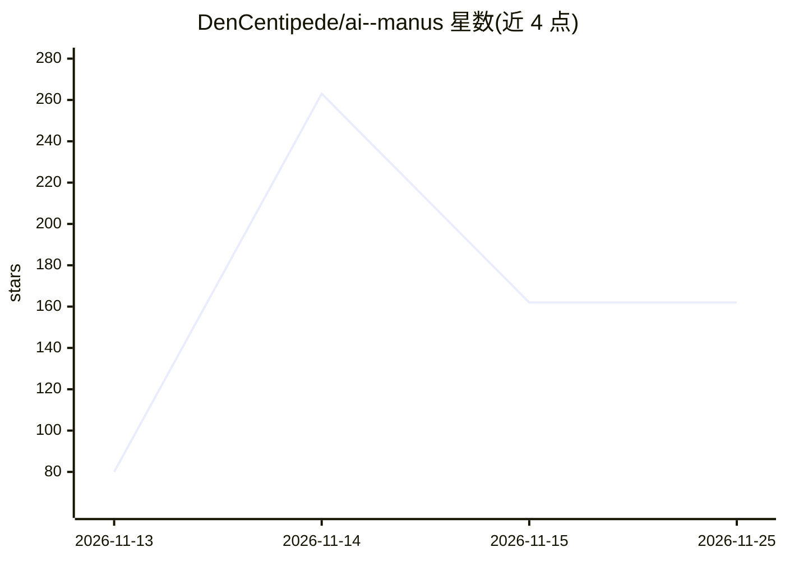

# DenCentipede/ai--manus

⭐ 162 · Apache-2.0 · 推送 2026-11-15 · [GitHub](https://github.com/DenCentipede/ai--manus) · 个人维护

**面向日常任务的自主 AI Agent：自动执行代码与浏览器操作**

README 宣称的自主 AI Agent 系统，定位为在沙箱环境中运行工具与操作的通用 Agent：可自主编写并执行脚本、控制浏览器（导航网页、填表、采集信息）、执行多步骤任务，面向家庭、学习与轻量办公场景的用户。文档给出硬件兼容表（最低双核 CPU / 4 GB 内存）与使用流程说明，但 README 未提供代码结构、模型接入方式或安装命令，技术实现细节不可验证。

## 筛选速览

| 维度 | 判定 | 备注 |
|---|---|---|
| AI 角色 | `ai-native` | 本体是模型或模型工具 |
| 许可风险 | `permissive` | Apache-2.0 |
| 部署形态 | `None` |  |
| 模型依赖 | — | README 未给出锁定关系 |
| 硬件要求 | — | 无带数字的原话,不猜 |
| 安装摩擦 | `low` | 无编译、无系统依赖或容器化 |
| 成熟度 | — | 结构信号不足 |

## 能力要点

- 自主代码执行：Agent 自行编写并运行脚本完成任务
- 浏览器控制：导航网页、填写表单、采集信息
- 代码与浏览器动作在同一任务流中衔接
- 面向多会话的一致性：记住并复用已解释的工作流模式

## 适用场景

- 让学生整理研究笔记、运行小型计算脚本
- 代替人工在多个网页间采集与汇总信息
- 把重复性的小型日常任务委托给后台 Agent 处理

## 场景标签

`编码 Agent` `浏览器自动化` · 领域:效率与自动化

## 证据(README 行号)

> L10: - **Autonomous Code Execution:** Manus AI agent runs code on its own to complete tasks, so you can focus on decisio
> L18: Manus is an autonomous AI agent designed to run code and control a browser on your behalf. Instead of acting like a

## 星数曲线

2026-11-13 80 → 2026-11-25 162（+82）

---
*卡片 v1 · prompt 1.4 · 生成 2026-11-17 · 置信度 mid · 依据 README sha `0f78ee3a5dd2` · [字段定义](../../DATASET.md)*
