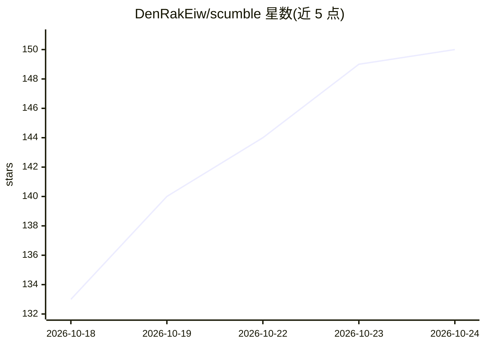

# DenRakEiw/scumble

⭐ 150 · JavaScript · GPL-3.0 · 推送 2026-10-23 · [GitHub](https://github.com/DenRakEiw/scumble) · [官网](https://www.denrakeiw.com/scumble) · 个人维护

**AI 图像编辑器：选定区域、输入提示词，生成色彩匹配的新图层**

面向图像编辑用户的桌面应用（GPL-3.0，Electron）。选区或画框后输入提示词，AI 生成结果作为独立图层返回，边缘渐隐、自动色彩匹配，可蒙版、混合、加滤镜。渲染途径：自有 ComfyUI（需配套 InpaintCanvas 节点包）、Comfy Cloud，或直接粘贴 FLUX、GPT Image、Nano Banana、Seedream、Qwen 等 API key。功能含 PSD/OpenRaster 图层导出、GPU 滤镜图层、深度图与 SAM 选区、114 个工具的 MCP 服务器。版本 0.1.x，作者自述有未端到端测试的功能；Windows 提供 Store/安装器/便携版，Linux 为 CI 构建未经作者运行，macOS 未开始。

## 筛选速览

| 维度 | 判定 | 备注 |
|---|---|---|
| AI 角色 | `ai-native` | 本体是模型或模型工具 |
| 许可风险 | `viral` | GPL-3.0 |
| 部署形态 | `desktop` | 安装包/桌面程序 |
| 模型依赖 | locked-api |  |
| 硬件要求 | — | 无带数字的原话,不猜 |
| 安装摩擦 | `low` | 无编译、无系统依赖或容器化 |
| 成熟度 | `idea` | |

## 能力要点

- 生成结果作为独立图层返回，含色彩匹配滑杆与边缘对齐
- 支持自有 ComfyUI、Comfy Cloud 或 API key 三种渲染途径
- 提供 114 个工具的 MCP 服务器，可由 Claude Code/Desktop 等 MCP 客户端驱动
- PSD/OpenRaster 图层导出，GPU 滤镜图层与内置 SAM2/深度图等本地模型

## 适用场景

- 对照片局部重绘/移除/替换，结果作为可编辑图层叠加
- 用画框+提示词在空白画布上生成多元素新图
- 把 AI 生成与 PSD 图层工作流结合导出成品

## 场景标签

`图像生成` `图像视频处理` · 领域:内容生成

## 证据(README 行号)

> L3:  An AI-native image editor for ComfyUI and the models you already use.
> L34: Scumble is a desktop image editor built around AI models. Select part of a picture, or draw boxes on an empty

## 星数曲线

2026-10-18 133 → 2026-10-24 150（+17）

---
*卡片 v1 · prompt 1.4 · 生成 2026-10-22 · 置信度 mid · 依据 README sha `e827e0a10b17` · [字段定义](../../DATASET.md)*
