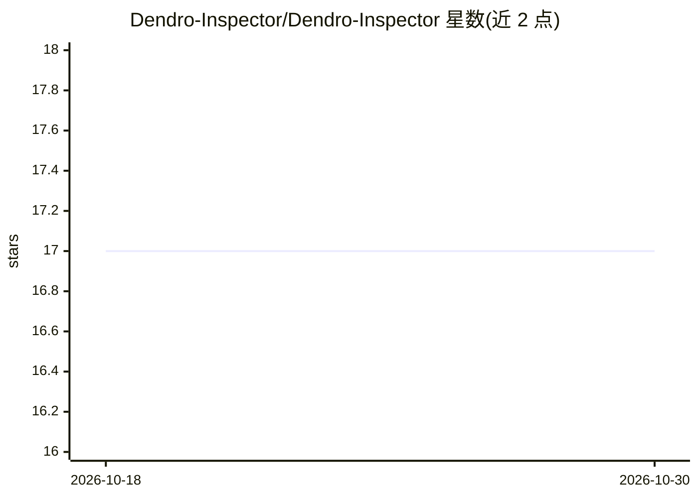

# Dendro-Inspector/Dendro-Inspector

⭐ 17 · Python · Apache-2.0 · 推送 2026-10-07 · [GitHub](https://github.com/Dendro-Inspector/Dendro-Inspector) · 个人维护

**面向照片树木识别的多模态 agent 参考实现，核心是证据处理与评测**

以树木/木材照片识别为参照领域的多模态 agent 参考实现：输入照片经类型化观察、卡片验证候选、对抗式审查后输出五种有界判定状态之一（identified/probable/insufficient_evidence 等），分辨率在 family 到 species 之间且不强制到种。模型节点提案、确定性代码裁决证据上限与最终结论。默认答案为乌克兰语，可 --lang en 切换；提供 fake 模式（fixtures 回放，无需密钥/网络）与多 provider 接入（OpenAI/Anthropic/Gemini/NVIDIA/OpenRouter/Ollama）。自述 v0.9.0 为垂直切片而非生产系统，25 类群知识包未经树木学家审阅。

## 筛选速览

| 维度 | 判定 | 备注 |
|---|---|---|
| AI 角色 | `ai-native` | 本体是模型或模型工具 |
| 许可风险 | `permissive` | Apache-2.0 |
| 部署形态 | `library` | 以包/库形式分发 |
| 模型依赖 | local-ok | 支持本地模型 |
| 硬件要求 | — | 无带数字的原话,不猜 |
| 安装摩擦 | `low` | 无编译、无系统依赖或容器化 |
| 成熟度 | `idea` | |

## 能力要点

- 可执行类型状态机：照片→类型化观察→卡片验证候选→对抗审查→有界决策
- 五种结果状态与 family~species 分辨率上限，证据不足时输出补拍计划而非猜测
- fake 模式用 fixtures 回放，全部测试/评测/CI 无需密钥与网络
- prompt 为不透明用户管理工件，经 hash 校验后原样传给模型

## 适用场景

- 研究多模态 agent 的证据处理、对抗审查与校准不确定性机制
- 以树木照片识别为例学习带评测与 CI 的 agent 工程实践
- 接入 OpenAI/Anthropic/Gemini/NVIDIA/OpenRouter/Ollama 运行真实模型端到端流程

## 场景标签

`多模态` `模型评测` · 领域:评测与运维

## 证据(README 行号)

> L13: An eval-driven, evidence-based, multimodal agent for identifying trees, logs, bark, leaves,
> L24: **What it is:** a reference implementation for evidence handling, adversarial review,
> L29: calibrated uncertainty, evaluation and CI. The 25-taxon knowledge pack shipped here is

## 星数曲线

2026-10-18 17 → 2026-10-30 17（+0）

---
*卡片 v1 · prompt 1.4 · 生成 2026-10-30 · 置信度 high · 依据 README sha `b9f9011bc6b4` · [字段定义](../../DATASET.md)*
