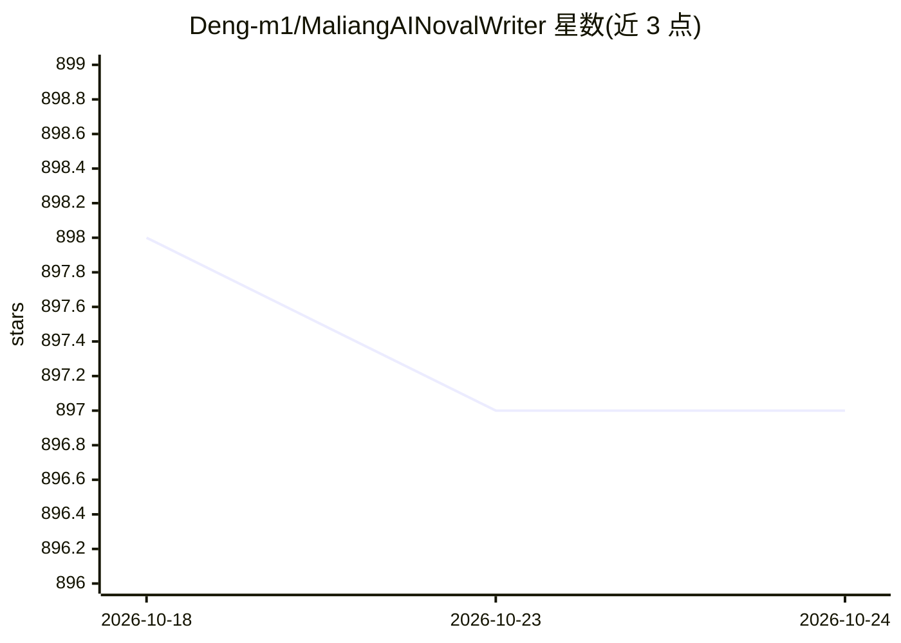

# Deng-m1/MaliangAINovalWriter

⭐ 898 · 推送 2026-08-20 · [GitHub](https://github.com/Deng-m1/MaliangAINovalWriter) · [官网](https://maliangwriter.com/) · 个人维护 · 中文 README

**面向中文网文作者的AI小说创作平台，支持30万字级连载**

基于 Flutter Web + Spring Boot 3 的AI小说创作平台，面向小说作者与平台运营者。提供富文本编辑器、作品-卷-章节-场景四级内容管理、三级大纲生成、AI生成结构化世界观设定树、剧情推演（多模型抽卡生成剧情分支）、AI拆书知识库与写作统计。模型接入支持 OpenAI、Claude、Gemini 及 OpenRouter 兼容模型，用户可配私有 API Key，管理员可配置公共模型池并提供 LLM 调用日志、计费审计、RBAC 用户管理等后台。通过 Docker 一键部署（镜像内置后端 JAR 与 Web 静态文件），需 MongoDB，向量库用 Chroma；番茄小说拆书功能依赖第三方服务。

## 筛选速览

| 维度 | 判定 | 备注 |
|---|---|---|
| AI 角色 | `ai-native` | 本体是模型或模型工具 |
| 许可风险 | `none` | — |
| 部署形态 | `self-host` | docker 或自建部署 |
| 模型依赖 | locked-api |  |
| 硬件要求 | — | 无带数字的原话,不猜 |
| 安装摩擦 | `low` | 无编译、无系统依赖或容器化 |
| 成熟度 | — | 结构信号不足 |

## 能力要点

- AI生成结构化世界观设定树，支持增量修改与历史快照
- 剧情推演：多模型同时生成多个后续剧情分支并可独立重生成
- AI拆书从小说文本提取文风、情节、人物等创作知识入知识库
- 管理员后台含 LLM 可观测性、模型计费审计、RBAC 与订阅积分管理

## 适用场景

- 网文作者用AI续写、润色、剧情推演完成长篇连载
- 从txt导入现有作品并由AI生成各章大纲完成迁移
- 平台运营者部署后统一管理用户、公共模型与调用成本

## 场景标签

`AI 写作` `知识库管理` · 领域:内容生成

## 证据(README 行号)

> L14: 马良AI写作是一个专为小说作者与平台运营者设计的智能化创作平台。它结合了强大的AI模型（支持OpenAI, Gemini, Anthropic等）与专业的在线富文本编辑器，旨在帮助作者激发灵感、提高写作效率、管理创作内容，同时为平
> L18: > **AINoval (Maliang Writer / 马良写作)** is an open-source AI novel writer built for Chinese webnovels (网文). It pairs 
> L425: - **个人作者**:

## 星数曲线

2026-10-18 898 → 2026-10-24 897（-1）

---
*卡片 v1 · prompt 1.4 · 生成 2026-10-21 · 置信度 high · 依据 README sha `af37df3aeb25` · [字段定义](../../DATASET.md)*
