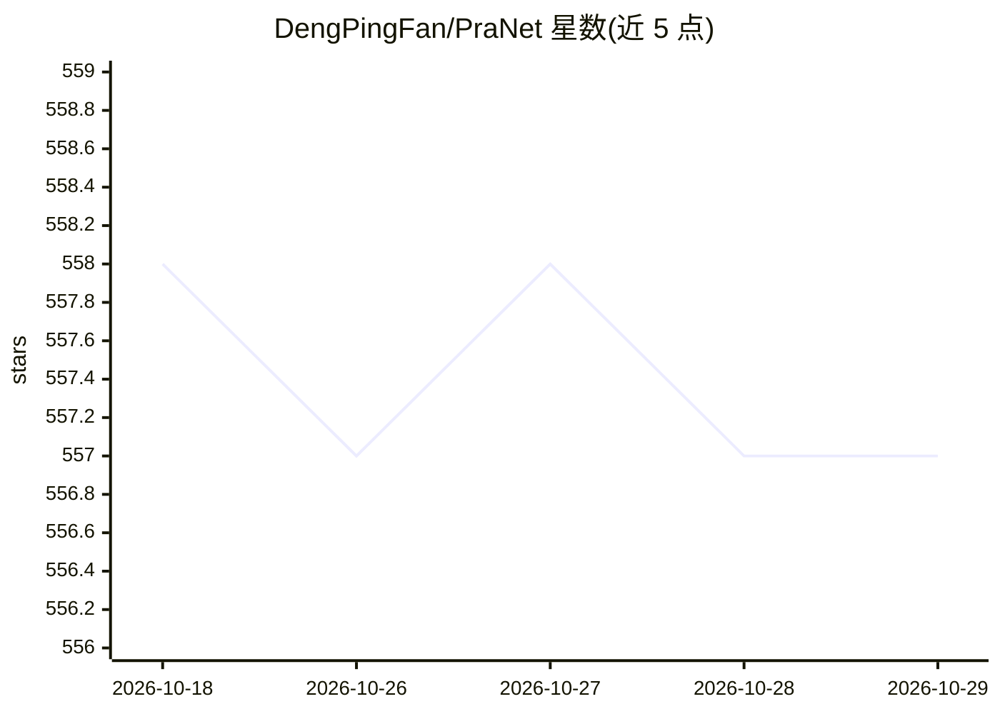

# DengPingFan/PraNet

⭐ 557 · Python · 推送 2025-12-11 · [GitHub](https://github.com/DengPingFan/PraNet) · [官网](http://dpfan.net/PraNet) · 组织维护 · 中文 README

**结肠镜息肉分割模型：并行反向注意力网络（MICCAI 2020）**

MICCAI 2020 口头报告论文的官方代码库：PraNet 用并行部分解码器（PPD）聚合高层特征生成全局引导图，再经反向注意力（RA）模块挖掘边界线索，通过区域与边界的迭代协作校准预测，在五个息肉分割数据集上评估并报告约 50fps 的分割效率。提供 PyTorch 训练/测试代码、预训练权重（Res2Net 骨干）、训练与测试数据集下载及 MATLAB 评估工具；后续版本 PraNet-V2 引入 DSRA 模块扩展多类分割。面向医学图像分割研究者。

## 筛选速览

| 维度 | 判定 | 备注 |
|---|---|---|
| AI 角色 | `ai-native` | 本体是模型或模型工具 |
| 许可风险 | `none` | — |
| 部署形态 | `None` |  |
| 模型依赖 | — | README 未给出锁定关系 |
| 硬件要求 | — | 无带数字的原话,不猜 |
| 安装摩擦 | `low` | 无编译、无系统依赖或容器化 |
| 成熟度 | — | 结构信号不足 |

## 能力要点

- 并行部分解码器（PPD）+ 反向注意力（RA）模块的分割架构
- 提供 PyTorch 训练/测试代码、预训练权重与五个测试数据集
- 支持低显存 GPU（可降低 batch size）
- MATLAB 一键评估工具箱与预计算结果图

## 适用场景

- 在 Kvasir/CVC 等数据集上复现息肉分割实验
- 以 PraNet 作为基线开发医学图像分割方法
- 使用预训练权重生成结肠镜图像的息肉分割预测

## 场景标签

`目标检测` · 领域:感知与多模态

## 证据(README 行号)

> L25: - This repository provides code for "_**PraNet: Parallel Reverse Attention Network for Polyp Segmentation**_" MICCA
> L96: To address these challenges, we propose a parallel reverse attention network (PraNet) for accurate polyp segmentati
> L120: The training and testing experiments are conducted using PyTorch with

## 星数曲线

2026-10-18 558 → 2026-10-29 557（-1）

---
*卡片 v1 · prompt 1.4 · 生成 2026-10-21 · 置信度 high · 依据 README sha `e18defa6e36a` · [字段定义](../../DATASET.md)*
