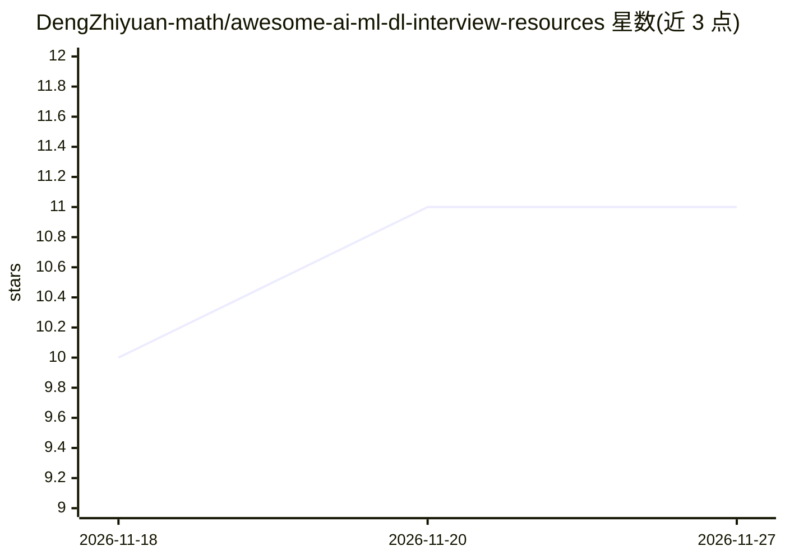

# DengZhiyuan-math/awesome-ai-ml-dl-interview-resources

⭐ 11 · MIT · 推送 2026-07-20 · [GitHub](https://github.com/DengZhiyuan-math/awesome-ai-ml-dl-interview-resources) · 个人维护 · 中文 README

**AI/ML/LLM 面试题库策展清单与学习路线**

面向 AI/机器学习/深度学习/LLM 与 ML 系统设计面试求职者的资源索引：收录并分类 12 个外部题库/练习项目，按理论、Transformer/LLM、PyTorch 实现与系统设计四条技能线组织，提供按目标选择的快速指南、七步学习路径与使用方法说明。链接经核验（2026-07-20），并附 resources.yml 机器可读数据与贡献流程；各链接项目的问答内容版权归原项目所有。

## 筛选速览

| 维度 | 判定 | 备注 |
|---|---|---|
| AI 角色 | `ai-knowledge` | 知识聚合/清单类 |
| 许可风险 | `permissive` | MIT |
| 部署形态 | `None` |  |
| 模型依赖 | — | README 未给出锁定关系 |
| 硬件要求 | — | 无带数字的原话,不猜 |
| 安装摩擦 | `low` | 无编译、无系统依赖或容器化 |
| 成熟度 | — | 结构信号不足 |

## 能力要点

- 收录 12 个经链接核验的面试题库/练习项目，附角色、覆盖面与评分
- 按 ML/DL 理论、Transformers/LLMs、PyTorch 实现、ML 系统设计四技能线组织
- resources.yml 提供全部 12 个资源的机器可读数据
- 提供按目标选资源的快速指南与七步学习路径

## 适用场景

- 准备 ML 工程师/应用科学家岗位的面试
- 按知识图谱定位自己的理论或实现盲区
- 用 PyTorch 练习题库做面试前编码训练
- 面试前做口头快问快答复习

## 场景标签

`精选清单` · 领域:学习与行业

## 证据(README 行号)

> L5: A curated, categorized, and link-verified collection of interview question banks for artificial intelligence, machin
> L147: - resources.yml contains machine-readable data for all 12 resources.

## 星数曲线

2026-11-18 10 → 2026-11-27 11（+1）

---
*卡片 v1 · prompt 1.4 · 生成 2026-11-20 · 置信度 high · 依据 README sha `931e0dffa572` · [字段定义](../../DATASET.md)*
