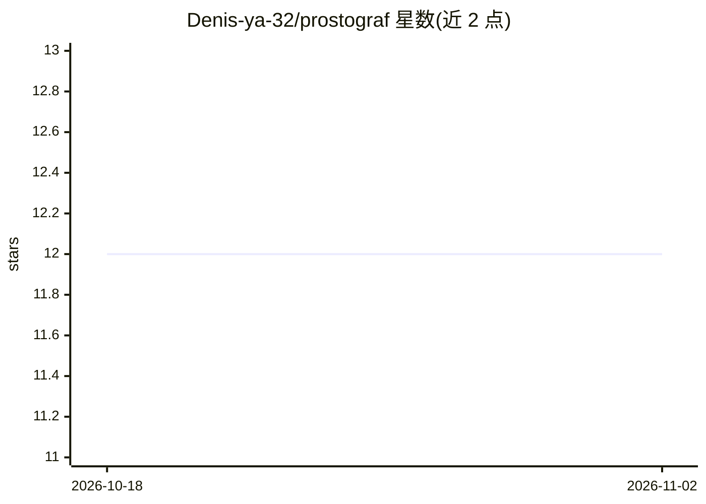

# Denis-ya-32/prostograf

⭐ 12 · Python · MIT · 推送 2026-10-27 · [GitHub](https://github.com/Denis-ya-32/prostograf) · 个人维护 · 中文 README

**自托管多用户图 RAG 文档问答系统（LightRAG 深度分支）**

面向团队与部门的自托管「基于文档提问」系统，为 LightRAG（HKUDS）深度分支：保留其图引擎，外加强制登录（JWT）、admin/user 角色、按部门的文档 ACL、带评分的服务端聊天历史、运营商级提示词与提供商连通性测试及俄语界面。支持任意 OpenAI 兼容提供商（OpenRouter/DeepSeek/OpenAI/vLLM/Groq/Ollama/LM Studio）与可选重排器（Cohere/Jina/Aliyun）。开箱解析 PDF/DOCX/XLSX，扫描件需自建 MinerU/Docling OCR。通过 Docker Compose 部署，嵌入模型首次索引后不可更换。

## 筛选速览

| 维度 | 判定 | 备注 |
|---|---|---|
| AI 角色 | `ai-native` | 本体是模型或模型工具 |
| 许可风险 | `permissive` | MIT |
| 部署形态 | `self-host` | docker 或自建部署 |
| 模型依赖 | local-ok | 支持本地模型 |
| 硬件要求 | — | 无带数字的原话,不猜 |
| 安装摩擦 | `low` | 无编译、无系统依赖或容器化 |
| 成熟度 | — | 结构信号不足 |

## 能力要点

- 图 RAG：知识图谱+向量检索，naive/local/global/hybrid/mix 五种查询模式
- 强制登录、admin/user 角色与按部门文档 ACL（禁止文档不会进入回答）
- 任意 OpenAI 兼容提供商 + 提供商连通性测试（显示响应码与延迟）
- 服务端聊天历史与 👍/👎 评分反馈，管理员页面含统计与筛选

## 适用场景

- 团队或部门私有化部署文档问答，按部门隔离文档权限
- 组织内部知识库检索与溯源问答，收集用户反馈
- 在自有 Docker 环境中运行可自选 LLM 提供商的 RAG 服务

## 场景标签

`文档问答` · 领域:知识与检索

## 证据(README 行号)

> L11: **ПростоГраф** — это самостоятельно размещаемая система «спроси по своим документам» на основе **графового RAG**. П
> L17: - 🧠 **Графовый RAG** — граф знаний + векторный поиск; режимы `naive` / `local` / `global` / `hybrid` / `mix`.

## 星数曲线

2026-10-18 12 → 2026-11-02 12（+0）

---
*卡片 v1 · prompt 1.4 · 生成 2026-11-01 · 置信度 high · 依据 README sha `f17b9465f2b3` · [字段定义](../../DATASET.md)*
