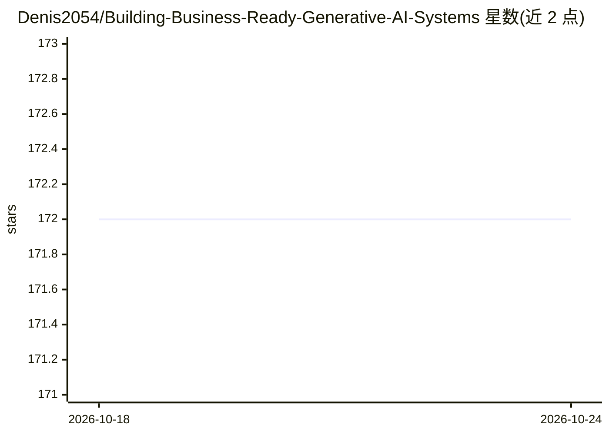

# Denis2054/Building-Business-Ready-Generative-AI-Systems

⭐ 172 · Jupyter Notebook · MIT · 推送 2026-02-11 · [GitHub](https://github.com/Denis2054/Building-Business-Ready-Generative-AI-Systems) · 个人维护

**生成式 AI 系统构建教程的配套代码库（书籍 notebooks）**

Packt 出版书籍《Building Business-Ready Generative AI Systems》的官方代码仓库，由作者 Denis Rothman 维护，提供全书 10 章的 Jupyter notebook，内容涵盖 AI 控制器与编排器、短期/长期/跨会话记忆、基于 Pinecone 的动态 RAG、多模态推理、Chain-of-Thought 编排、消费记忆 Agent、DeepSeek-R1 集成、轨迹预测与多智能体系统。notebook 可在 Colab/Kaggle/Studio Lab 免费运行，需 OpenAI、Activeloop、Pinecone 的 API token，依赖以 requirements_01.txt 提供。

## 筛选速览

| 维度 | 判定 | 备注 |
|---|---|---|
| AI 角色 | `ai-knowledge` | 知识聚合/清单类 |
| 许可风险 | `permissive` | MIT |
| 部署形态 | `None` |  |
| 模型依赖 | — | README 未给出锁定关系 |
| 硬件要求 | — | 无带数字的原话,不猜 |
| 安装摩擦 | `low` | 无编译、无系统依赖或容器化 |
| 成熟度 | — | 结构信号不足 |

## 能力要点

- 10 章配套 notebook 覆盖 AI 控制器、RAG、多模态与多智能体
- 全部 notebook 支持 Colab/Kaggle/Studio Lab 云端运行
- 依赖清单含 openai、transformers、Pinecone、DeepSeek-R1-Distill-Llama-8B
- 仓库持续更新（README 标注最后更新 2026-02-11）

## 适用场景

- 跟随书籍章节动手实现企业级生成式 AI 系统
- 在 Colab 免费环境运行 AI 控制器与 RAG 示例
- 学习多智能体与多模态编排的实现方式

## 场景标签

`教程课程` · 领域:学习与行业

## 证据(README 行号)

> L3:  This is the code repository for Building Business-Ready Generative AI Systems, First Edition, published by Packt.
> L51: |Chapters|Colab|Kaggle|Studio Lab|
> L86: You should have basic **Natural Processing Language** (**NLP**) knowledge and some experience with Python. Addition

## 星数曲线

2026-10-18 172 → 2026-10-24 172（+0）

---
*卡片 v1 · prompt 1.4 · 生成 2026-10-22 · 置信度 high · 依据 README sha `3ae2aeca0377` · [字段定义](../../DATASET.md)*
