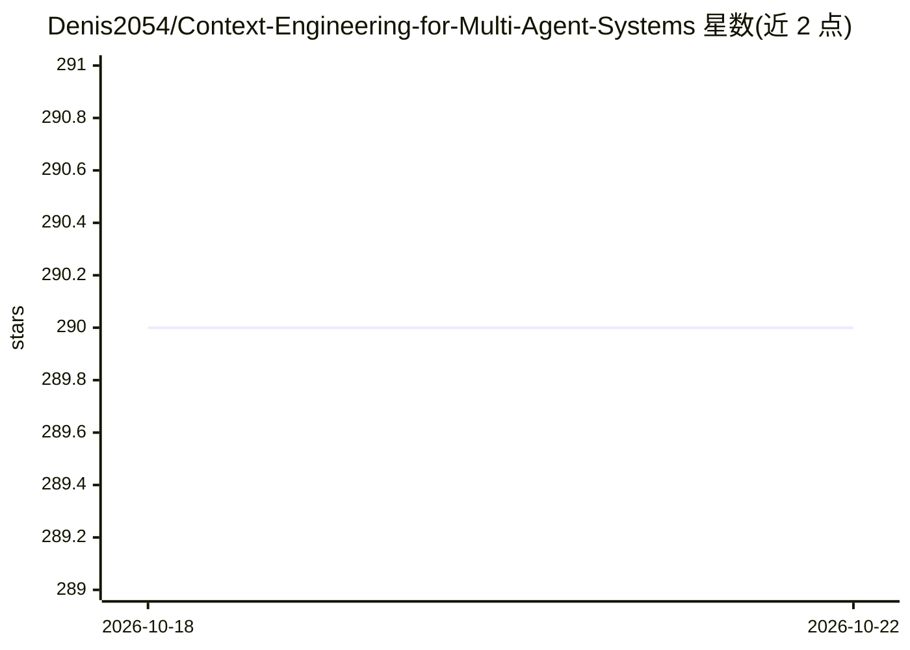

# Denis2054/Context-Engineering-for-Multi-Agent-Systems

⭐ 290 · Jupyter Notebook · MIT · 推送 2026-10-11 · [GitHub](https://github.com/Denis2054/Context-Engineering-for-Multi-Agent-Systems) · [官网](https://www.linkedin.com/in/denis-rothman-0b034043/) · 个人维护

**多智能体系统 Context Engine 蓝图：领域无关的语义编排架构**

Denis Rothman 所著《Context Engineering for Multi-Agent Systems》配套代码仓库，提供领域无关的‘玻璃盒’Context Engine 蓝图：以语义蓝图、MCP 编排、双通道 RAG（指令+事实）、记忆、遥测与 Token 成本分析构建多智能体系统。同一架构可在 OpenAI+Pinecone、LangChain、本地 DeepSeek-R1、NVIDIA Nemotron 等载体上运行，另有 Claude Projects 无代码版本（纯 Markdown 协议文件）。以章节笔记本（Colab/Kaggle/Studio Lab）形式交付，含 Gradio UI 与 Docker/Railway 部署资源。

## 筛选速览

| 维度 | 判定 | 备注 |
|---|---|---|
| AI 角色 | `ai-ecosystem` | LLM/agent 周边工具 |
| 许可风险 | `permissive` | MIT |
| 部署形态 | `None` |  |
| 模型依赖 | — | README 未给出锁定关系 |
| 硬件要求 | — | 无带数字的原话,不猜 |
| 安装摩擦 | `low` | 无编译、无系统依赖或容器化 |
| 成熟度 | — | 结构信号不足 |

## 能力要点

- 领域无关核心：同一架构跨法律/营销等场景运行，不改代码
- 双通道 RAG（指令与事实）带输入净化与可溯源引用
- Glass Box 可观测性：交互式 trace 面板与执行日志
- 载体无关：OpenAI+Pinecone/LangChain/DeepSeek-R1/Nemotron/Claude Projects 多种实现

## 适用场景

- 按蓝图搭建可跨领域复用的多智能体 Context Engine
- 学习从提示工程转向上下文工程的架构方法
- 在本地 DeepSeek-R1 上构建不依赖外部 API 的主权 AI 系统

## 场景标签

`多智能体` `RAG` `Agent 框架` · 领域:Agent 开发

## 证据(README 行号)

> L9: This repository provides a production-ready blueprint for the Agentic Era, allowing you to replace rigid, hard-coded
> L86:  Substrate Independence: The same architecture runs on OpenAI + Pinecone, on LangChain/LangGraph, on a local DeepSe

## 星数曲线

2026-10-18 290 → 2026-10-22 290（+0）

---
*卡片 v1 · prompt 1.4 · 生成 2026-10-22 · 置信度 high · 依据 README sha `de56c3272070` · [字段定义](../../DATASET.md)*
