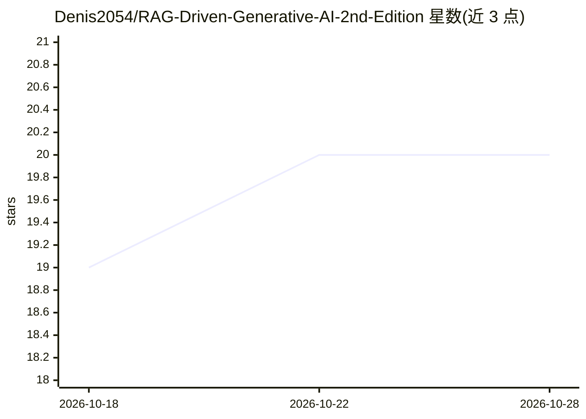

# Denis2054/RAG-Driven-Generative-AI-2nd-Edition

⭐ 20 · Jupyter Notebook · MIT · 推送 2026-05-07 · [GitHub](https://github.com/Denis2054/RAG-Driven-Generative-AI-2nd-Edition) · [官网](https://www.linkedin.com/in/denis-rothman-0b034043/) · 个人维护

**RAG 生成式 AI 第二版配套代码库：Oracle 数据库内构建主权 RAG 系统**

Denis Rothman 所著《RAG-Driven Generative AI, Second Edition》(Packt) 的配套 GitHub 仓库，提供 12 章的 Jupyter notebook，可在 Colab/Kaggle/Studio Lab 运行。内容围绕在 Oracle AI Database 26ai（23ai 引擎）内构建 RAG：Dual RAG（向量语义与结构化 SQL 同步）、MAS-RAG 多智能体上下文引擎、融合 Spatial 与 SQL/PGQ 的超查询、多模态视频 RAG、Exadata 扩展与自主数据库架构师 agent。要求 Python/SQL 基础、Oracle Cloud Free Tier 账号与 OpenAI API key。

## 筛选速览

| 维度 | 判定 | 备注 |
|---|---|---|
| AI 角色 | `ai-knowledge` | 知识聚合/清单类 |
| 许可风险 | `permissive` | MIT |
| 部署形态 | `None` |  |
| 模型依赖 | — | README 未给出锁定关系 |
| 硬件要求 | — | 无带数字的原话,不猜 |
| 安装摩擦 | `low` | 无编译、无系统依赖或容器化 |
| 成熟度 | — | 结构信号不足 |

## 能力要点

- 12 章 notebook 覆盖 Dual RAG、MAS-RAG、GraphRAG、多模态视频 RAG
- 融合向量、Oracle Spatial 与 SQL/PGQ 的单一超查询（零数据移动）
- Hybrid Adaptive RAG 推理时路由：模型推理/检索/人工反馈切换
- 基于 Exadata AI Smart Scan 的向量负载扩展

## 适用场景

- 跟着书籍章节在 Colab 中实践 Oracle 数据库内的 RAG 架构
- 企业场景下构建不外传数据的主权 RAG 系统
- 学习多智能体 RAG 与混合检索管线的设计

## 场景标签

`RAG` `多智能体` `知识图谱` `教程课程` · 领域:Agent 开发

## 证据(README 行号)

> L1: # RAG-Driven Generative AI, Second Edition
> L38: ## Interactive Notebooks for Every Chapter
> L40: |Chapters|Colab|Kaggle|Studio Lab|

## 星数曲线

2026-10-18 19 → 2026-10-28 20（+1）

---
*卡片 v1 · prompt 1.4 · 生成 2026-10-28 · 置信度 high · 依据 README sha `95a2006cfcd0` · [字段定义](../../DATASET.md)*
