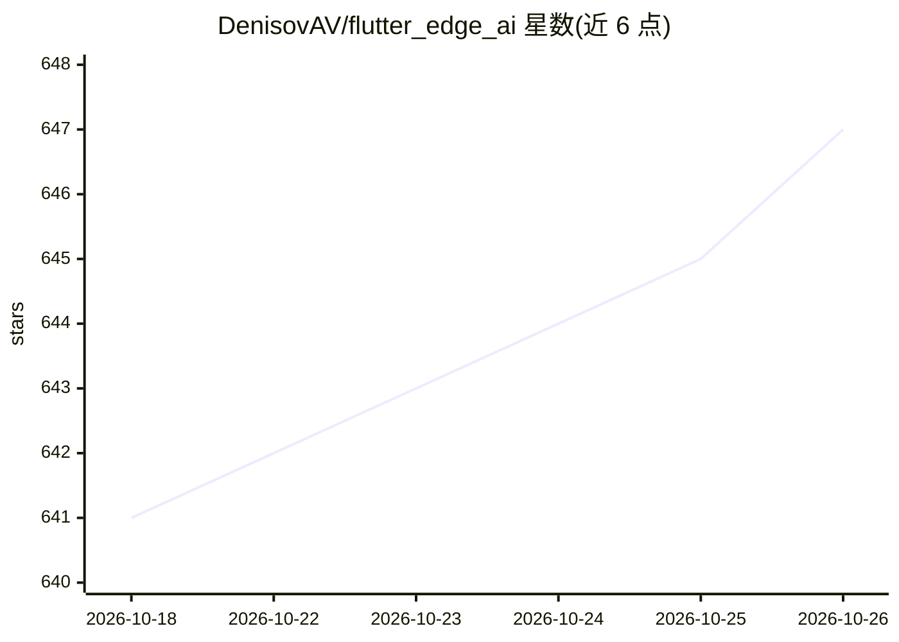

# DenisovAV/flutter_edge_ai

⭐ 647 · Dart · MIT · 推送 2026-10-25 · [GitHub](https://github.com/DenisovAV/flutter_edge_ai) · [官网](https://flutteredge.ai) · 组织维护

**Flutter 端侧 AI 框架：多引擎运行 LLM、语音与 RAG**

面向 Flutter 开发者的端侧 AI 包族：核心包负责模型安装与引擎注册，各运行时与功能均为独立可选 pub 包。支持 5 类引擎（LiteRT-LM、MediaPipe、llama.cpp、ONNX Runtime、操作系统内置模型），覆盖文本、视觉、音频、函数调用、嵌入与端侧 RAG（SQLite/Qdrant 向量存储），另有语音、Agent 技能、Genkit 混合路由等包。无需服务器与云，跨 Android/iOS/Web/macOS/Windows/Linux 六平台。旧名 flutter_gemma* 仍在发布。

## 筛选速览

| 维度 | 判定 | 备注 |
|---|---|---|
| AI 角色 | `ai-ecosystem` | LLM/agent 周边工具 |
| 许可风险 | `permissive` | MIT |
| 部署形态 | `None` |  |
| 模型依赖 | local-ok | 支持本地模型 |
| 硬件要求 | — | 无带数字的原话,不猜 |
| 安装摩擦 | `low` | 无编译、无系统依赖或容器化 |
| 成熟度 | — | 结构信号不足 |

## 能力要点

- 核心包 + 各运行时/功能独立可选包的模块化结构
- 5 类引擎：LiteRT-LM、MediaPipe、llama.cpp、ONNX、OS 内置模型
- 端侧 RAG：RagIndex、嵌入分词器与 SQLite/Qdrant 向量存储
- Agent 技能（SKILL.md）与 MCP 工具、Genkit 端云混合路由

## 适用场景

- 在 Flutter 应用中离线运行 LLM 对话、视觉与语音功能
- 构建端侧 RAG 检索问答应用
- 通过 Genkit 混合路由在端侧与云端模型间切换

## 场景标签

`语音合成` `RAG` `推理引擎` `语音识别` · 领域:内容生成

## 证据(README 行号)

> L17: The core package is small: it installs models and hands them to engines. Every
> L26: |`flutter_edge_ai`|Core: model installation, the engine registry, sessions and chat. Required by every package exce

## 星数曲线

2026-10-18 641 → 2026-10-26 647（+6）

---
*卡片 v1 · prompt 1.4 · 生成 2026-10-21 · 置信度 high · 依据 README sha `325157e681ba` · [字段定义](../../DATASET.md)*
