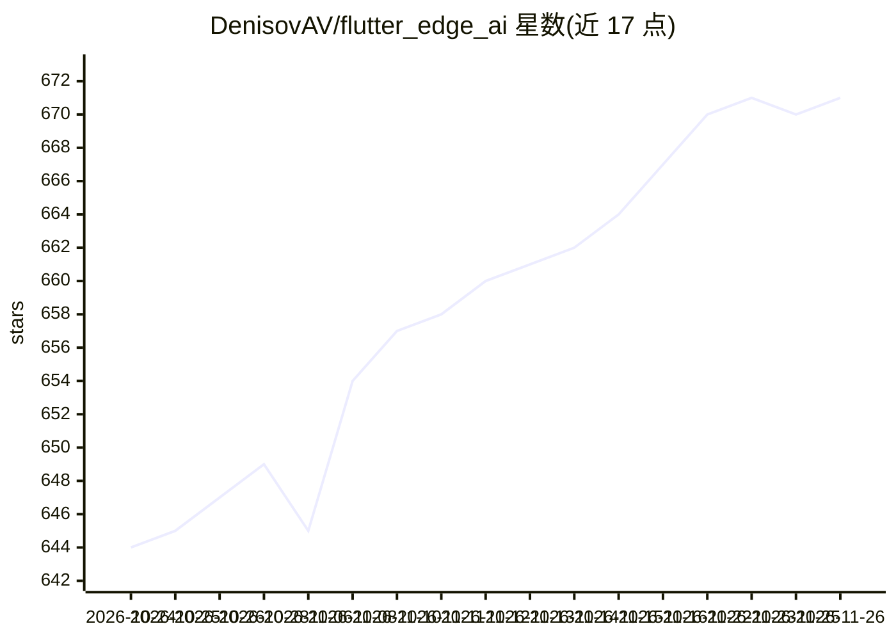

# DenisovAV/flutter_edge_ai

⭐ 671 · Dart · MIT · 推送 2026-11-25 · [GitHub](https://github.com/DenisovAV/flutter_edge_ai) · [官网](https://flutteredge.ai) · 组织维护

**Flutter 端侧 AI 插件集：本地运行 LLM/RAG/语音**

面向 Flutter 开发者的端侧 AI 插件家族，覆盖 Android、iOS、Web、macOS、Windows 和 Linux。核心包负责模型安装、引擎注册、会话与聊天，其余功能按可选包拆分：LiteRT-LM、MediaPipe、llama.cpp、ONNX Runtime 等推理引擎，系统自带模型（Gemini Nano、Apple Foundation Models 等）接入，嵌入与 RAG（SQLite/Qdrant 向量库）、语音、Agent 技能与内存诊断。全部本地运行，无服务器、无云端。原 flutter_gemma 系列已改名。

## 筛选速览

| 维度 | 判定 | 备注 |
|---|---|---|
| AI 角色 | `ai-ecosystem` | LLM/agent 周边工具 |
| 许可风险 | `permissive` | MIT |
| 部署形态 | `None` |  |
| 模型依赖 | local-ok | 支持本地模型 |
| 硬件要求 | — | 无带数字的原话,不猜 |
| 安装摩擦 | `low` | 无编译、无系统依赖或容器化 |
| 成熟度 | — | 结构信号不足 |

## 能力要点

- 多引擎接入：LiteRT-LM、MediaPipe、llama.cpp、ONNX Runtime 与 OS 内置模型
- 端侧 RAG：嵌入分词器、RagIndex 与 sqlite-vec/Qdrant 向量库
- 语音包提供 STT、TTS 与 VoiceSession 语音循环
- Genkit 插件支持端侧与云端模型混合路由

## 适用场景

- 在 Flutter 应用中离线运行本地大模型对话
- 为移动端应用添加本地 RAG 知识检索
- 在端侧实现语音交互与会话功能

## 场景标签

`语音合成` `RAG` `推理引擎` `语音识别` · 领域:内容生成

## 证据(README 行号)

> L6: On-device AI for Flutter on Android, iOS, Web, macOS, Windows and Linux. Run any
> L17: The core package is small: it installs models and hands them to engines. Every

## 星数曲线

2026-10-24 644 → 2026-11-26 671（+27）

---
*卡片 v1 · prompt 1.4 · 生成 2026-11-24 · 置信度 high · 依据 README sha `87ef6b37bb56` · [字段定义](../../DATASET.md)*
