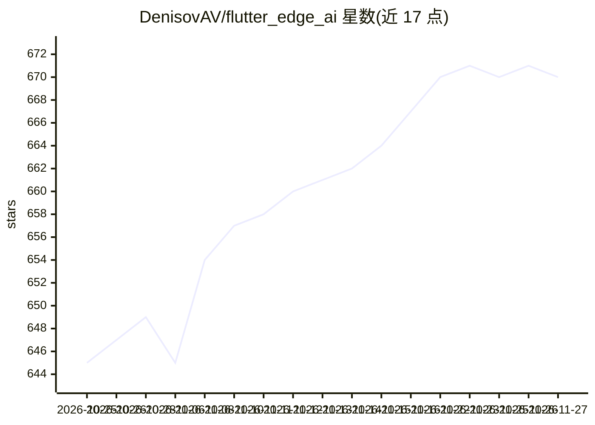

# DenisovAV/flutter_edge_ai

⭐ 670 · Dart · MIT · 推送 2026-11-26 · [GitHub](https://github.com/DenisovAV/flutter_edge_ai) · [官网](https://flutteredge.ai) · 组织维护

**Flutter 端侧 AI 插件族：离线运行 LLM、RAG 与语音**

面向 Flutter 开发者的端侧 AI 插件集合，覆盖 Android、iOS、Web、macOS、Windows、Linux。核心包负责模型安装、引擎注册与会话/聊天；运行时引擎（LiteRT-LM、MediaPipe、llama.cpp、ONNX Runtime、系统自带模型）与向量存储、语音、Agent 诊断等均为独立可选包，按需引入。不支持服务器/云端部署，推理全部在设备本地完成。MIT 许可，前身为 flutter_gemma 系列包名。

## 筛选速览

| 维度 | 判定 | 备注 |
|---|---|---|
| AI 角色 | `ai-ecosystem` | LLM/agent 周边工具 |
| 许可风险 | `permissive` | MIT |
| 部署形态 | `None` |  |
| 模型依赖 | local-ok | 支持本地模型 |
| 硬件要求 | — | 无带数字的原话,不猜 |
| 安装摩擦 | `low` | 无编译、无系统依赖或容器化 |
| 成熟度 | — | 结构信号不足 |

## 能力要点

- 多引擎注册机制：LiteRT-LM/MediaPipe/llama.cpp/ONNX/OS 自带模型可插拔
- 端侧 RAG：sqlite-vec、Qdrant Edge、any-sync 等多种向量存储
- 语音包提供 STT/TTS 与 VoiceSession 语音循环
- Agent 技能（SKILL.md）与 MCP 工具调用支持

## 适用场景

- 在 Flutter 应用中离线运行 Gemma 等 LLM 完成文本/视觉/音频任务
- 在移动端构建本地 RAG 问答
- 调用系统自带模型（Gemini Nano、Apple Foundation Models）无需下载
- 构建带语音交互的端侧 Agent 应用

## 场景标签

`语音合成` `RAG` `推理引擎` `语音 Agent` · 领域:对话与助手

## 证据(README 行号)

> L17: The core package is small: it installs models and hands them to engines. Every
> L26: |`flutter_edge_ai`|Core: model installation, the engine registry, sessions and chat. Required by every package exce
> L28: |`flutter_edge_ai_litertlm`|LiteRT-LM (`.litertlm`) through `dart:ffi` on the five native platforms plus web; CPU, 

## 星数曲线

2026-10-25 645 → 2026-11-27 670（+25）

---
*卡片 v1 · prompt 1.4 · 生成 2026-11-26 · 置信度 high · 依据 README sha `bbf22a1c2880` · [字段定义](../../DATASET.md)*
