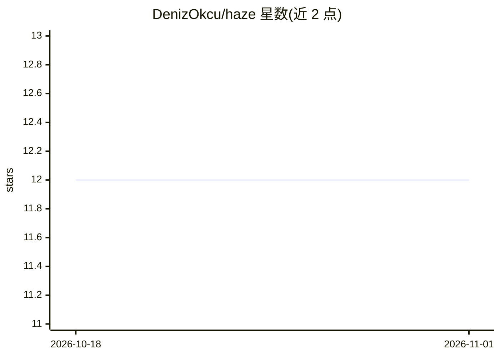

# DenizOkcu/haze

⭐ 12 · TypeScript · MIT · 推送 2026-10-31 · [GitHub](https://github.com/DenizOkcu/haze) · [官网](https://denizokcu.github.io/haze/) · 个人维护

**面向开发者的极简终端 LLM 编码 agent（harness）**

npm 全局安装的命令行 LLM agent：接入任意 OpenAI 兼容端点（OpenRouter、OpenAI、LM Studio、Ollama、代理等），通过 shell 与文件工具在终端中执行任务，支持 MCP 服务器扩展工具、会话持久化与 fork、上下文压缩、推理等级控制及无头运行。监督模式上不设沙箱与权限层，依赖用户本人监督工具调用，明确声明不是无人值守自动化运行时。运行需 macOS/Linux 与 Node.js 22+，Windows 尚未支持。

## 筛选速览

| 维度 | 判定 | 备注 |
|---|---|---|
| AI 角色 | `ai-ecosystem` | LLM/agent 周边工具 |
| 许可风险 | `permissive` | MIT |
| 部署形态 | `library` | 以包/库形式分发 |
| 模型依赖 | local-ok | 支持本地模型 |
| 硬件要求 | — | 无带数字的原话,不猜 |
| 安装摩擦 | `low` | 无编译、无系统依赖或容器化 |
| 成熟度 | — | 结构信号不足 |

## 能力要点

- 接入任意 OpenAI 兼容端点（OpenRouter/LM Studio/Ollama 等）与 MCP 服务器
- 无沙箱无权限层、依赖用户现场监督的轻量 guardrail 设计
- 会话持久化、fork、上下文压缩与无头模式（-p/--output json/stream-json）
- 针对本地推理服务器（LM Studio/Ollama）设置独立的空闲流超时窗口

## 适用场景

- 在终端里让 LLM 用 shell 与文件工具操作当前项目
- 接入本地 Ollama/LM Studio 模型做日常开发任务
- 用 MCP 服务器为 agent 追加工具（如 Context7 文档查询）

## 场景标签

`编码 Agent` · 领域:编码与开发

## 证据(README 行号)

> L62: haze works with OpenAI-compatible providers, including OpenRouter and local endpoints. Use `/provider` to choose or
> L102: `/provider` sets up any OpenAI-compatible endpoint, such as OpenRouter, OpenAI, LM Studio, Ollama, or a proxy. haz
> L77: There is **no sandbox and no permission layer**: the shell tool runs unsupervised in your login shell (its classifi

## 星数曲线

2026-10-18 12 → 2026-11-01 12（+0）

---
*卡片 v1 · prompt 1.4 · 生成 2026-11-01 · 置信度 high · 依据 README sha `f2a00651bf9d` · [字段定义](../../DATASET.md)*
