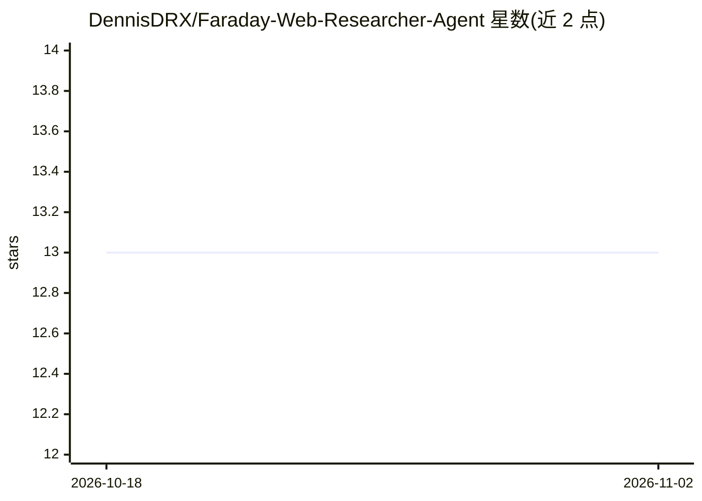

# DennisDRX/Faraday-Web-Researcher-Agent

⭐ 13 · Python · 推送 2026-10-13 · [GitHub](https://github.com/DennisDRX/Faraday-Web-Researcher-Agent) · 个人维护

**自主网络研究 Agent：多源检索并合成结构化报告**

基于 LangGraph 与 Streamlit 构建的自主网络研究代理：用户输入查询后，Agent 通过 Tavily、Google、NewsAPI 等动态工具从多个来源抓取信息，合成结构化报告，并记录全部来源供核查。支持工具动态扩展与研究流程中的手动调整，界面用于输入查询、选择工具和查看报告。以 Python 实现并通过 git clone 与 pip 安装依赖后以 streamlit run 启动，Releases 区另提供可下载文件。

## 筛选速览

| 维度 | 判定 | 备注 |
|---|---|---|
| AI 角色 | `ai-native` | 本体是模型或模型工具 |
| 许可风险 | `none` | — |
| 部署形态 | `library` | 以包/库形式分发 |
| 模型依赖 | — | README 未给出锁定关系 |
| 硬件要求 | — | 无带数字的原话,不猜 |
| 安装摩擦 | `low` | 无编译、无系统依赖或容器化 |
| 成熟度 | — | 结构信号不足 |

## 能力要点

- Tavily/Google/NewsAPI 等动态工具的多源信息抓取
- 信息合成结构化报告并记录全部来源
- 基于 Streamlit 的 Web 界面，可选择工具与查看报告
- 工具可扩展，研究流程允许手动调整

## 适用场景

- 输入问题让 Agent 自动完成多源网络调研
- 生成带来源追踪的结构化研究报告
- 按需选择检索工具定制调研流程

## 场景标签

`科研工具` · 领域:学习与行业

## 证据(README 行号)

> L6: Welcome to the **Faraday-Web-Researcher-Agent** repository! This project aims to provide an autonomous web research 
> L12: - **Autonomous Web Research**: Faraday uses tools like Tavily, Google, and NewsAPI to fetch relevant information.
> L27: - **LLM**: Large Language Models for enhanced research capabilities.

## 星数曲线

2026-10-18 13 → 2026-11-02 13（+0）

---
*卡片 v1 · prompt 1.4 · 生成 2026-10-31 · 置信度 high · 依据 README sha `6fe691771841` · [字段定义](../../DATASET.md)*
