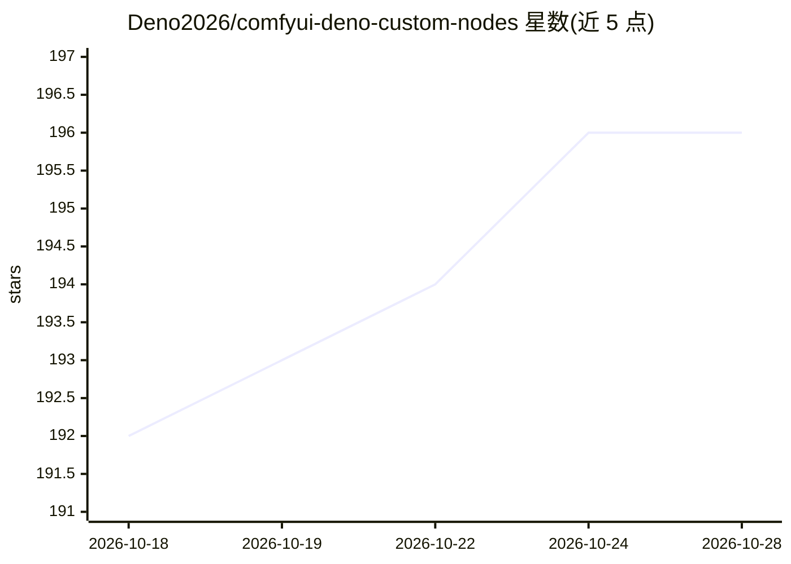

# Deno2026/comfyui-deno-custom-nodes

⭐ 196 · Python · GPL-3.0 · 推送 2026-10-24 · [GitHub](https://github.com/Deno2026/comfyui-deno-custom-nodes) · [官网](https://github.com/Deno2026/comfyui-deno-custom-nodes#readme) · 个人维护 · 中文 README

**ComfyUI 自定义节点包：媒体加载/比较与生成工作流辅助工具**

面向 ComfyUI 用户的自定义节点集合：提供图像加载与批量管理、Resize Box 分辨率/裁剪缩放、视频比较、Film Grain 等媒体处理节点；生成工作流方面包含 Ideogram Director 可视化 prompt/bbox 构建器、MiniMax H3、LTX、RTX 视频工具与本地 LLM 加载辅助。另含画布整理（Visual Fold）、浮动工具（VRAM 释放、错误报告生成）、资源监控及若干浏览器端工具（视频比较、GIF/WebP 转换、Discord 压缩）。通过 ComfyUI Manager 或手动安装，各模型节点有各自的前置要求。

## 筛选速览

| 维度 | 判定 | 备注 |
|---|---|---|
| AI 角色 | `ai-ecosystem` | LLM/agent 周边工具 |
| 许可风险 | `viral` | GPL-3.0 |
| 部署形态 | `library` | 以包/库形式分发 |
| 模型依赖 | local-ok | 支持本地模型 |
| 硬件要求 | — | 无带数字的原话,不猜 |
| 安装摩擦 | `medium` | 含编译或系统依赖之一 |
| 成熟度 | — | 结构信号不足 |

## 能力要点

- Ideogram Director：画布上直接绘制/编辑 bbox 的可视化 prompt 构建器，输出结构化 JSON 字段
- Resize Box：比率预设、百万像素计算、可拖拽裁剪与 lanczos 插值
- Visual Fold：将选中节点折叠为紧凑视觉组而不改动工作流逻辑
- 浏览器端 Web Tools：视频比较、Video to GIF/WebP、Discord 媒体压缩（无需安装）

## 适用场景

- 在 ComfyUI 中准备和批量管理输入图像并按目标分辨率调整
- 对比两个渲染视频的效果差异
- 用可视化界面构建 Ideogram 4 的结构化提示词与布局
- 整理大型工作流画布并监控 CPU/GPU/VRAM 资源

## 场景标签

`图像视频处理` `视频生成` · 领域:内容生成

## 证据(README 行号)

> L9: Practical ComfyUI nodes for loading and resizing images, comparing video results, and building model workflows.
> L12: - **Build a generation workflow:** Ideogram, MiniMax H3, LTX, RTX video tools, and local LLM helpers.
> L21: 1. Open **ComfyUI Manager**, search for `Deno Custom Nodes`, and install the package.

## 星数曲线

2026-10-18 192 → 2026-10-28 196（+4）

---
*卡片 v1 · prompt 1.4 · 生成 2026-10-22 · 置信度 mid · 依据 README sha `757d07e8c5f1` · [字段定义](../../DATASET.md)*
