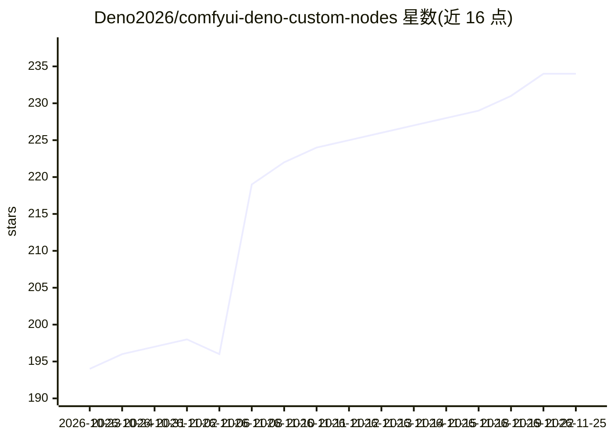

# Deno2026/comfyui-deno-custom-nodes

⭐ 234 · Python · GPL-3.0 · 推送 2026-11-22 · [GitHub](https://github.com/Deno2026/comfyui-deno-custom-nodes) · [官网](https://github.com/Deno2026/comfyui-deno-custom-nodes#readme) · 组织维护

**面向 ComfyUI 的自定义节点集，覆盖生成工作流全流程**

一组 ComfyUI 自定义节点包，按生产流程组织为五个步骤：准备（多种图像加载器与裁剪缩放）、生成（LTX/MiniMax H3/Bernini 相关节点、LoRA 加载器、本地 LLM 加载器）、对比（图像/视频对比与预览）、收尾（胶片颗粒、RTX Video Super Resolution）、整理（节点折叠与浮动工具）。通过 ComfyUI Manager 安装，另提供三个浏览器端 Web 工具。RTX 节点要求 Windows、NVIDIA RTX 与 nvidia-vfx 0.2+。

## 筛选速览

| 维度 | 判定 | 备注 |
|---|---|---|
| AI 角色 | `ai-ecosystem` | LLM/agent 周边工具 |
| 许可风险 | `viral` | GPL-3.0 |
| 部署形态 | `library` | 以包/库形式分发 |
| 模型依赖 | local-ok | 支持本地模型 |
| 硬件要求 | — | 无带数字的原话,不猜 |
| 安装摩擦 | `medium` | 含编译或系统依赖之一 |
| 成熟度 | — | 结构信号不足 |

## 能力要点

- 按 Prepare/Generate/Compare/Finish/Organize 五阶段组织的节点集
- RTX Video Super Resolution 节点调用 NVIDIA VSR/High Bitrate/Denoise/Deblur（需 Windows + NVIDIA RTX + nvidia-vfx 0.2+）
- MiniMax H3 Tiled Sampler 以重叠分块完成高分辨率视频推理，使 16GB GPU 可运行
- 本地 LLM Loader 限定 Ollama 与 LM Studio 的固定本地地址（v0.7.129 安全调整）

## 适用场景

- 在 ComfyUI 工作流中做图像/视频的前后处理与结果对比
- 用分块采样在 16GB 显存 GPU 上完成高分辨率视频生成
- 在大规模 ComfyUI 图中用折叠与节点信息按钮保持可读性

## 场景标签

`图像生成` `视频生成` `图像视频处理` · 领域:内容生成

## 证据(README 行号)

> L9:  Practical ComfyUI nodes for the whole production loop.
> L17: > **v0.7.129** limits Local LLM Loader to Ollama and LM Studio at their fixed local addresses on the computer runni
> L27: Start with a working ComfyUI installation.

## 星数曲线

2026-10-23 194 → 2026-11-25 234（+40）

---
*卡片 v1 · prompt 1.4 · 生成 2026-11-25 · 置信度 mid · 依据 README sha `ab65457a7088` · [字段定义](../../DATASET.md)*
