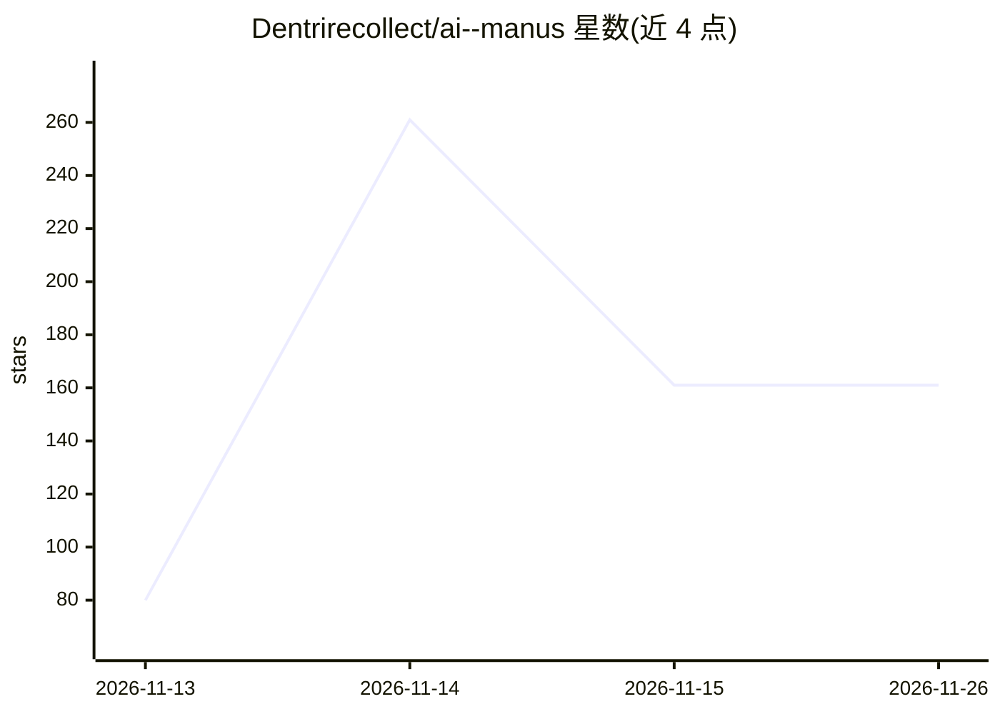

# Dentrirecollect/ai--manus

⭐ 161 · Apache-2.0 · 推送 2026-11-15 · [GitHub](https://github.com/Dentrirecollect/ai--manus) · 个人维护

**面向个人用户的自主 AI Agent：代写代码并控制浏览器完成多步任务**

Manus 是一个自主 AI Agent 系统，在沙箱环境中运行工具与操作，可自主编写并执行脚本、控制浏览器导航网页/填表/采集信息，并执行多步日常任务，定位为家庭、学习与轻量办公场景的个人助手，面向不希望学习完整编程栈的普通用户。README 提供兼容性表（最低 4GB 内存、双核 CPU）与六步上手流程（准备、配置、测试、细化、应用、维护）。未给出具体安装命令、模型接入方式或 API 说明，功能描述以能力罗列为主。

## 筛选速览

| 维度 | 判定 | 备注 |
|---|---|---|
| AI 角色 | `ai-native` | 本体是模型或模型工具 |
| 许可风险 | `permissive` | Apache-2.0 |
| 部署形态 | `None` |  |
| 模型依赖 | — | README 未给出锁定关系 |
| 硬件要求 | — | 无带数字的原话,不猜 |
| 安装摩擦 | `low` | 无编译、无系统依赖或容器化 |
| 成熟度 | — | 结构信号不足 |

## 能力要点

- 自主代码执行：agent 自行编写并运行脚本完成任务
- 浏览器控制：自动导航网页、填表、采集信息
- 代码与浏览器在同一流程中衔接，跨工具完成多步任务
- 跨会话保持一致的工作流模式

## 适用场景

- 让学生整理研究笔记并运行小脚本
- 让 agent 从多个网页自动收集数据并汇总
- 处理日常重复性事务，减少手工操作

## 场景标签

`AI 助手` `编码 Agent` `浏览器自动化` · 领域:效率与自动化

## 证据(README 行号)

> L10: - **Autonomous Code Execution:** Manus AI agent runs code on its own to complete tasks, so you can focus on decisio
> L18: Manus is an autonomous AI agent designed to run code and control a browser on your behalf. Instead of acting like a

## 星数曲线

2026-11-13 80 → 2026-11-26 161（+81）

---
*卡片 v1 · prompt 1.4 · 生成 2026-11-17 · 置信度 mid · 依据 README sha `0f78ee3a5dd2` · [字段定义](../../DATASET.md)*
