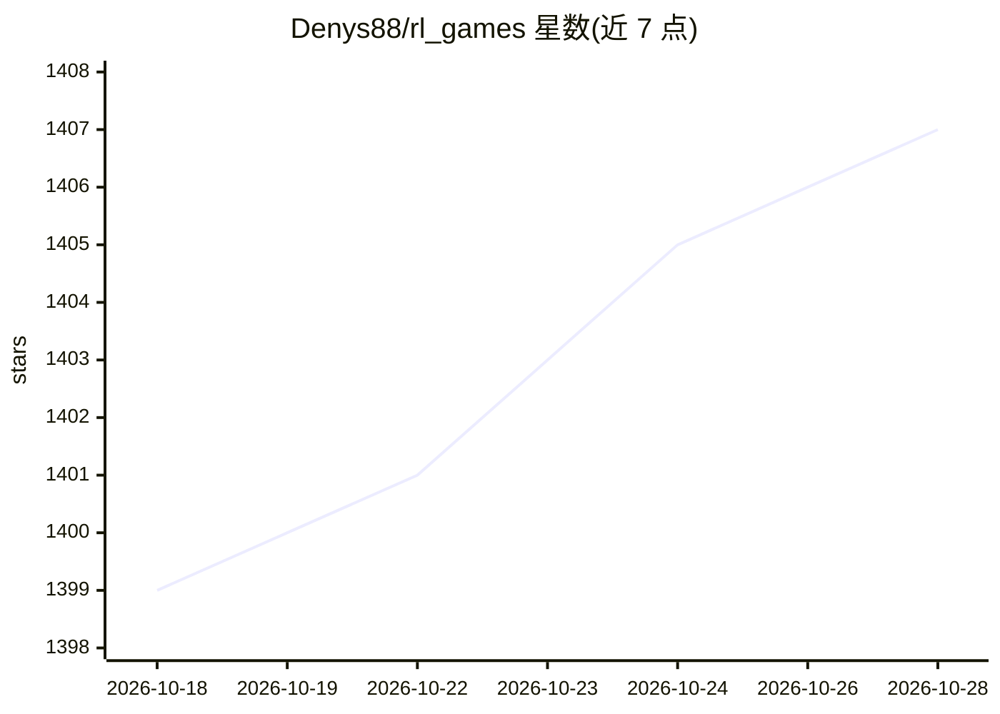

# Denys88/rl_games

⭐ 1,407 · Jupyter Notebook · MIT · 推送 2026-10-28 · [GitHub](https://github.com/Denys88/rl_games) · 个人维护

**面向 GPU 向量化仿真训练的 PyTorch 强化学习框架**

PyTorch 实现的强化学习框架，提供 PPO 与 SAC 算法，支持单 GPU 上数千环境并行、多 GPU 分布式训练（DistributedDataParallel）、非对称 actor-critic、RNN 策略、self-play、种群训练与 ONNX 导出。可接入 MJLab、Isaac Lab、EnvPool、MyoSuite、MuJoCo、Atari、DM Control、StarCraft 2 等仿真环境，面向机器人学与游戏强化学习研究者与开发者。2.0.0 版本要求 gymnasium 与 Python 3.11+；旧版 Isaac Gym 已停止支持（需 1.6.5 旧版本）。

## 筛选速览

| 维度 | 判定 | 备注 |
|---|---|---|
| AI 角色 | `ai-native` | 本体是模型或模型工具 |
| 许可风险 | `permissive` | MIT |
| 部署形态 | `library` | 以包/库形式分发 |
| 模型依赖 | — | README 未给出锁定关系 |
| 硬件要求 | — | 无带数字的原话,不猜 |
| 安装摩擦 | `medium` | 含编译或系统依赖之一 |
| 成熟度 | — | 结构信号不足 |

## 能力要点

- PPO/SAC 实现，非对称 actor-critic 与独立中心价值网络
- 单进程驱动数千环境，多 GPU DistributedDataParallel 训练
- 支持 ONNX 策略导出与 sim-to-real 部署流程
- PBT 观察器（rl_games.common.pbt）可配合任意后端使用

## 适用场景

- 在 MJLab/Isaac Lab 上做四足与人形机器人运动策略训练
- 用 SAC/PPO 跑 MuJoCo、Atari、DM Control 标准基准
- 导出 ONNX 策略并部署到真实机器人做 sim-to-real 迁移

## 场景标签

`强化学习` · 领域:训练与推理

## 证据(README 行号)

> L3:  High-performance reinforcement learning for GPU-vectorized simulation.
> L123: * PPO with the support of asymmetric actor-critic variant
> L125: * Support of end-to-end GPU accelerated training pipelines: MJLab (MuJoCo Warp), Isaac Lab. Legacy Isaac Gym: rl_g

## 星数曲线

2026-10-18 1,399 → 2026-10-28 1,407（+8）

---
*卡片 v1 · prompt 1.4 · 生成 2026-10-21 · 置信度 high · 依据 README sha `9e407b458ec4` · [字段定义](../../DATASET.md)*
