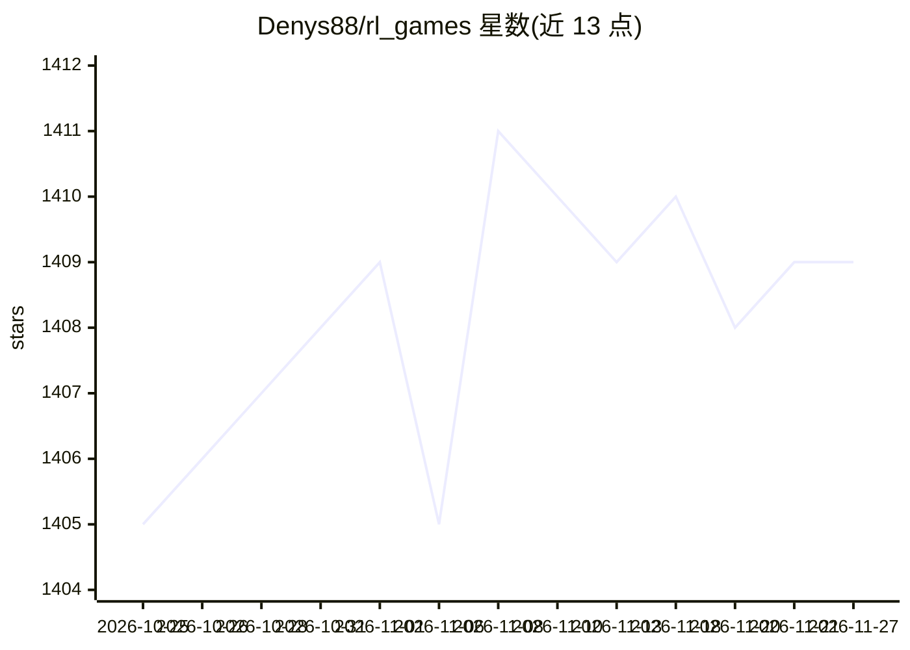

# Denys88/rl_games

⭐ 1,409 · Jupyter Notebook · MIT · 推送 2026-11-25 · [GitHub](https://github.com/Denys88/rl_games) · 个人维护

**面向 GPU 向量化仿真的强化学习训练框架**

基于 PyTorch 实现的强化学习库，提供 PPO（含非对称 actor-critic）与 SAC 算法，单进程驱动数千个并行环境，支持 DistributedDataParallel 多 GPU 训练、RNN 策略、Triton GAE、torch.compile、种群训练、self-play、ONNX 导出与实时查看器。可直接在 Isaac Lab、MJLab、EnvPool、MyoSuite 等环境上训练。通过 PyPI 或源码安装，Python 3.11/3.12，建议搭配 CUDA 的 PyTorch ≥2.2。README 大量给出机器人运动/灵巧操作的训练结果数据。

## 筛选速览

| 维度 | 判定 | 备注 |
|---|---|---|
| AI 角色 | `ai-native` | 本体是模型或模型工具 |
| 许可风险 | `permissive` | MIT |
| 部署形态 | `library` | 以包/库形式分发 |
| 模型依赖 | — | README 未给出锁定关系 |
| 硬件要求 | — | 无带数字的原话,不猜 |
| 安装摩擦 | `medium` | 含编译或系统依赖之一 |
| 成熟度 | — | 结构信号不足 |

## 能力要点

- 单进程驱动数千个 GPU 并行环境，支持多 GPU DDP 训练
- PPO 与 SAC 算法，非对称 actor-critic 与中心化 value 网络
- 支持 ONNX 导出、self-play、种群训练（PBT）与多智能体训练
- 提供 Colab 快速上手笔记本与实时查看器

## 适用场景

- 在 Isaac Lab / MJLab 中训练四足、人形机器人运动策略
- 通过 EnvPool 高吞吐训练 MuJoCo/Atari/DM Control 任务
- 导出 ONNX 策略做 sim-to-real 部署
- 运行多智能体（SMAC）与 self-play 实验

## 场景标签

`强化学习` · 领域:训练与推理

## 证据(README 行号)

> L3:  High-performance reinforcement learning for GPU-vectorized simulation.
> L4: PPO and SAC in PyTorch, thousands of environments per GPU, multi-GPU training, asymmetric actor-critic, ONNX export.
> L34: - **Built for GPU simulators.** One process drives thousands of environments. Asymmetric actor-critic with a separa

## 星数曲线

2026-10-25 1,405 → 2026-11-27 1,409（+4）

---
*卡片 v1 · prompt 1.4 · 生成 2026-11-26 · 置信度 high · 依据 README sha `48e156295875` · [字段定义](../../DATASET.md)*
