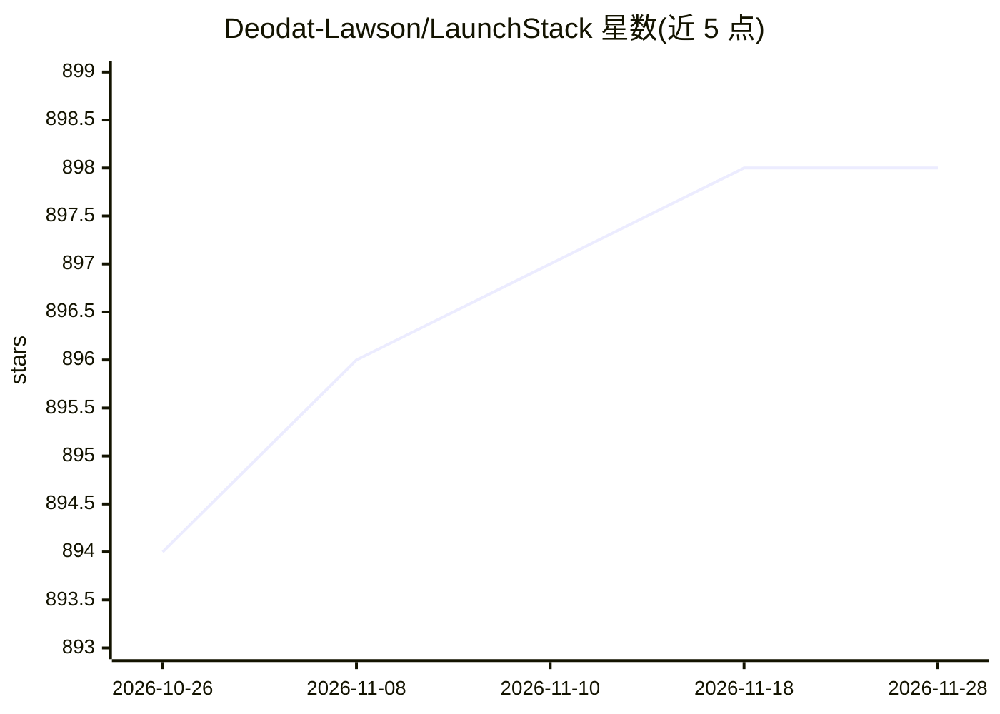

# Deodat-Lawson/LaunchStack

⭐ 898 · TypeScript · Apache-2.0 · 推送 2026-11-27 · [GitHub](https://github.com/Deodat-Lawson/LaunchStack) · 个人维护

**AI 原生应用引擎：文档摄取、RAG、知识图谱与后台任务**

TypeScript 编写的 AI 原生应用引擎，提供文档摄取、OCR、RAG、知识图谱、LLM 抽象与后台作业等可组合的“砖块”包（bricks），并通过 Next.js 参考应用展示组装方式。包经 ports 解耦，pipelines 组合出 12-13 个业务纵向功能（客户挖掘、营销、提案、趋势搜索等）。发布前形态：npm 包尚未发布，需通过仓库自托管（两命令 Docker 安装脚本）或本地源码运行，运行依赖 Node ≥20、pnpm 10.15.1 与带 pgvector 扩展的 Postgres。

## 筛选速览

| 维度 | 判定 | 备注 |
|---|---|---|
| AI 角色 | `ai-ecosystem` | LLM/agent 周边工具 |
| 许可风险 | `permissive` | Apache-2.0 |
| 部署形态 | `self-host` | docker 或自建部署 |
| 模型依赖 | locked-api |  |
| 硬件要求 | — | 无带数字的原话,不猜 |
| 安装摩擦 | `low` | 无编译、无系统依赖或容器化 |
| 成熟度 | `idea` | |

## 能力要点

- ports-based 的包分层：bricks 供 pipelines 组合，反向禁止导入
- 13 个产品纵向管线：客户挖掘、公司元数据、提案、趋势搜索等
- 摄取经事务性 outbox 由独立 worker 消费执行
- 支持 Gemini/Azure OpenAI，经 OpenAI chat-completions 协议统一接入

## 适用场景

- 搭建带文档上传、检索与对话的自托管知识工作台
- 为 AI 原生应用复用引擎包与管线组合
- 本地开发运行未发布代码并贡献引擎

## 场景标签

`RAG` `知识图谱` `文档解析` · 领域:知识与检索

## 证据(README 行号)

> L3: **A TypeScript engine for AI-native applications.** Ingestion, OCR, RAG, knowledge graph, LLM abstractions, and back
> L13: The publishable bricks in `packages/` and the compositions package `@launchstack/pipelines` are **not yet on npm**.
> L142: |`packages/`|The bricks: persistence, model calls, orchestration, conversion, indexing, retrieval, shared tools an

## 星数曲线

2026-10-26 894 → 2026-11-28 898（+4）

---
*卡片 v1 · prompt 1.4 · 生成 2026-11-28 · 置信度 mid · 依据 README sha `adc7c30b6273` · [字段定义](../../DATASET.md)*
