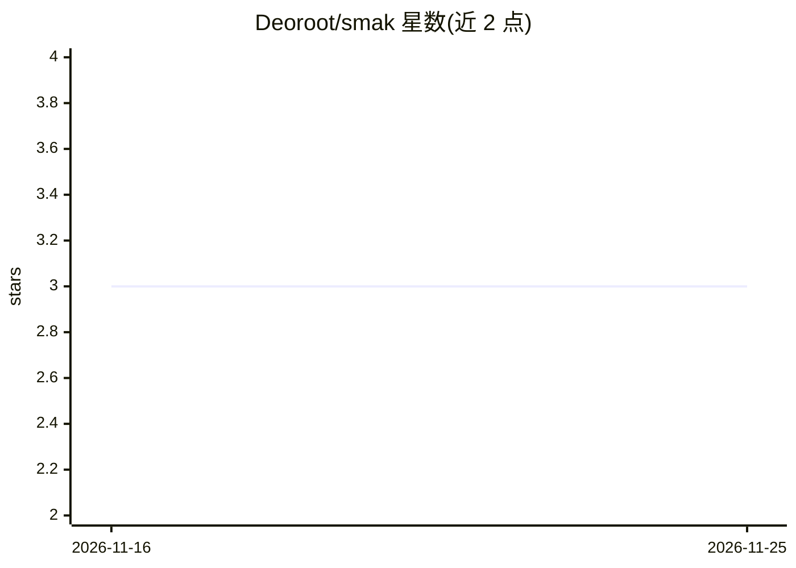

# Deoroot/smak

⭐ 3 · JavaScript · MIT · 推送 2026-11-15 · [GitHub](https://github.com/Deoroot/smak) · 个人维护

**让 AI 编码代理读写 GoldSrc 游戏模型与地图的工具包**

面向 AI 编码代理（如 Claude Code）的 Node 工具包：代理按 AGENTS.md 指引编写短脚本，直接读取/生成/修改/检查 GoldSrc 的模型（.mdl）、地图（.bsp/.map/.wad），并渲染图像自查；工作流为用户提需求、代理写脚本、SMAK 构建并按引擎规则校验、代理看图修正、用户在游戏中验收。支持地图、模型、动画、纹理制作，含行走测试、光照、门与天空缝隙等检查。无依赖，需 Node.js 18+。不打包任何游戏内容。

## 筛选速览

| 维度 | 判定 | 备注 |
|---|---|---|
| AI 角色 | `ai-ecosystem` | LLM/agent 周边工具 |
| 许可风险 | `permissive` | MIT |
| 部署形态 | `None` |  |
| 模型依赖 | — | README 未给出锁定关系 |
| 硬件要求 | — | 无带数字的原话,不猜 |
| 安装摩擦 | `low` | 无编译、无系统依赖或容器化 |
| 成熟度 | — | 结构信号不足 |

## 能力要点

- 直接读写 GoldSrc 游戏文件，无需反编译器、studiomdl 或 Blender
- 代理写脚本生成内容，并渲染玩家视角画面自查（含动画查看器与动作判定）
- 内置引擎限制与游戏规则的检查命令（check/walk test 等）
- 零依赖，Node.js 18+ 运行，npm test 自检

## 适用场景

- 让 AI 代理为 Half-Life 及其 mod 制作地图与道具模型
- 给现有模型改纹理或修补动画（如消除滑步、改进换弹动作）
- 为 Xash3D 角色扮演服务器搭建场景并逐轮巡查修正

## 场景标签

 · 领域:游戏/mod 开发工具

## 证据(README 行号)

> L3: SMAK is a toolkit for AI coding agents, such as Claude Code or any agent that runs commands and looks at pictures. I
> L58: 2. The agent reads `AGENTS.md`, finds the one guide the task needs, writes a short script with the kit, and runs it
> L62: SMAK reads and writes the game's files directly. It needs no decompiler, no studiomdl and no Blender, and there is

## 星数曲线

2026-11-16 3 → 2026-11-25 3（+0）

---
*卡片 v1 · prompt 1.4 · 生成 2026-11-22 · 置信度 high · 依据 README sha `2db598b69704` · [字段定义](../../DATASET.md)*
