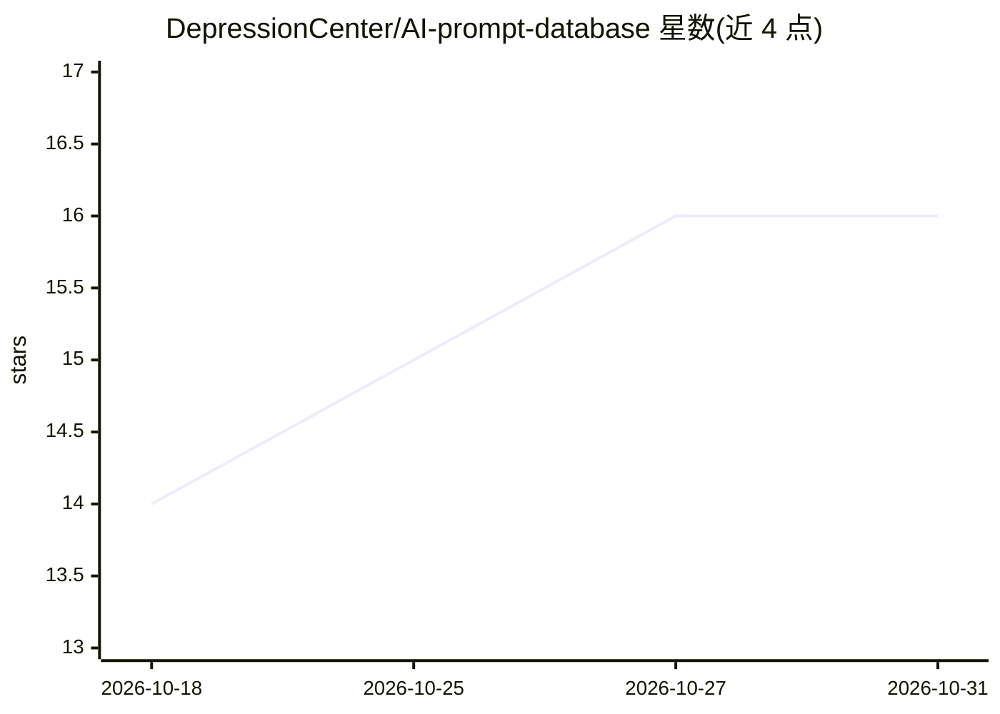

# DepressionCenter/AI-prompt-database

⭐ 16 · CSS · GPL-3.0 · 推送 2026-10-01 · [GitHub](https://github.com/DepressionCenter/AI-prompt-database) · [官网](https://teamdynamix.umich.edu/TDClient/210/DepressionCenter/KB/Article/10725/Tips-for-using-U-M-Generative-AI-Tools) · 组织维护

**密歇根大学维护的可复用 AI 提示词模板库**

由密歇根大学 Eisenberg Family Depression Center 的 Mobile Technologies Core 维护的开源提示词库，收录面向 UMGPT、Maizey、ChatGPT、Gemini、Claude 等助手的可复用提示词模板，按 Business、Clinical、Data Analysis、Education、Research、Web Development 等类别组织目录。使用方式为浏览目录、复制模板并粘贴到 AI 助手中；接受社区通过 pull request 贡献。仓库以 GPL-3.0 许可代码、GFDL 许可文档，并有 Zenodo DOI 供引用。本体为纯文档型仓库，无可安装软件。

## 筛选速览

| 维度 | 判定 | 备注 |
|---|---|---|
| AI 角色 | `ai-knowledge` | 知识聚合/清单类 |
| 许可风险 | `viral` | GPL-3.0 |
| 部署形态 | `None` |  |
| 模型依赖 | — | README 未给出锁定关系 |
| 硬件要求 | — | 无带数字的原话,不猜 |
| 安装摩擦 | `low` | 无编译、无系统依赖或容器化 |
| 成熟度 | — | 结构信号不足 |

## 能力要点

- 按 Business/Clinical/Data Analysis/Education 等多类别组织的提示词模板目录
- 模板面向 UMGPT、Maizey、ChatGPT、Gemini、Claude 等多种 AI 助手
- 每个文件带各自的文档与示例，/docs 目录含仓库指南与 agent skills 索引
- GPL-3.0（软件）+ GFDL（文档）双许可文件，附 Zenodo DOI

## 适用场景

- 研究者、教育者、临床人员查找现成提示词模板并适配自己的任务
- 研究协调员生成包容公平的研究知情同意等文书
- 数据分析与仪表盘开发中复用常见任务提示词

## 场景标签

`提示工程` `精选清单` · 领域:Agent 开发

## 证据(README 行号)

> L6: AI Prompt Database™ is an open-source library of reusable generative AI prompt examples for UMGPT, Maizey, ChatGPT, 
> L8: Browse a category, copy a prompt template, and adapt it to your task. Researchers, educators, clinicians, analysts, 

## 星数曲线

2026-10-18 14 → 2026-10-31 16（+2）

---
*卡片 v1 · prompt 1.4 · 生成 2026-10-30 · 置信度 high · 依据 README sha `8881592c5787` · [字段定义](../../DATASET.md)*
