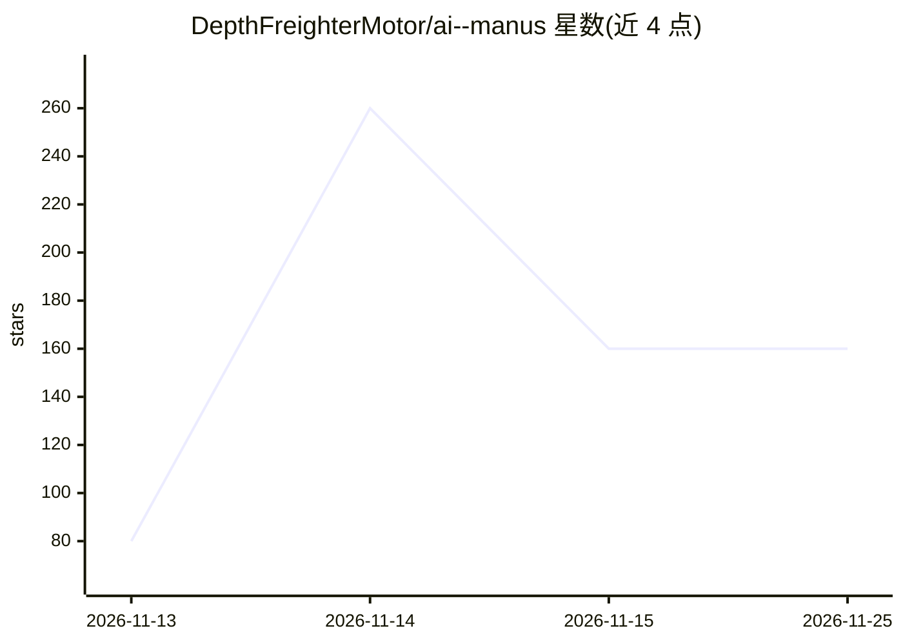

# DepthFreighterMotor/ai--manus

⭐ 160 · Apache-2.0 · 推送 2026-11-15 · [GitHub](https://github.com/DepthFreighterMotor/ai--manus) · 个人维护

**面向个人用户的自主 AI Agent：自动执行代码与浏览器操作**

自称 Manus 的通用自主 AI 代理系统：代表用户编写并执行脚本、控制浏览器导航页面/填表/采集信息，可执行多步骤任务并跨会话保持行为一致，定位为家庭、学习与轻办公场景的个人助手。README 描述了使用流程（配置、测试、逐步扩展）与硬件兼容表（最低双核 CPU、4 GB 内存）。但 README 未提供任何安装命令、下载入口、代码位置或模型接入方式，'Download Manus / PROMO2026' 仅出现无链接，可验证的落地信息有限。

## 筛选速览

| 维度 | 判定 | 备注 |
|---|---|---|
| AI 角色 | `ai-native` | 本体是模型或模型工具 |
| 许可风险 | `permissive` | Apache-2.0 |
| 部署形态 | `None` |  |
| 模型依赖 | — | README 未给出锁定关系 |
| 硬件要求 | — | 无带数字的原话,不猜 |
| 安装摩擦 | `low` | 无编译、无系统依赖或容器化 |
| 成熟度 | — | 结构信号不足 |

## 能力要点

- 自主执行代码与控制浏览器完成多步骤任务
- 代码与浏览器操作可在同一工作流中衔接
- 跨会话保持已学习的任务模式
- 提供最低/推荐硬件兼容表（4 GB 内存起步）

## 适用场景

- 让代理代为完成查网页、填表、整理文件等重复性小事
- 学生组织研究资料与运行快速计算
- 轻办公场景下从多页面采集信息并汇总

## 场景标签

`AI 助手` `浏览器自动化` `编码 Agent` `工作流自动化` · 领域:效率与自动化

## 证据(README 行号)

> L10: - **Autonomous Code Execution:** Manus AI agent runs code on its own to complete tasks, so you can focus on decisio
> L18: Manus is an autonomous AI agent designed to run code and control a browser on your behalf. Instead of acting like a

## 星数曲线

2026-11-13 80 → 2026-11-25 160（+80）

---
*卡片 v1 · prompt 1.4 · 生成 2026-11-17 · 置信度 low · 依据 README sha `a3d88e202bf0` · [字段定义](../../DATASET.md)*
