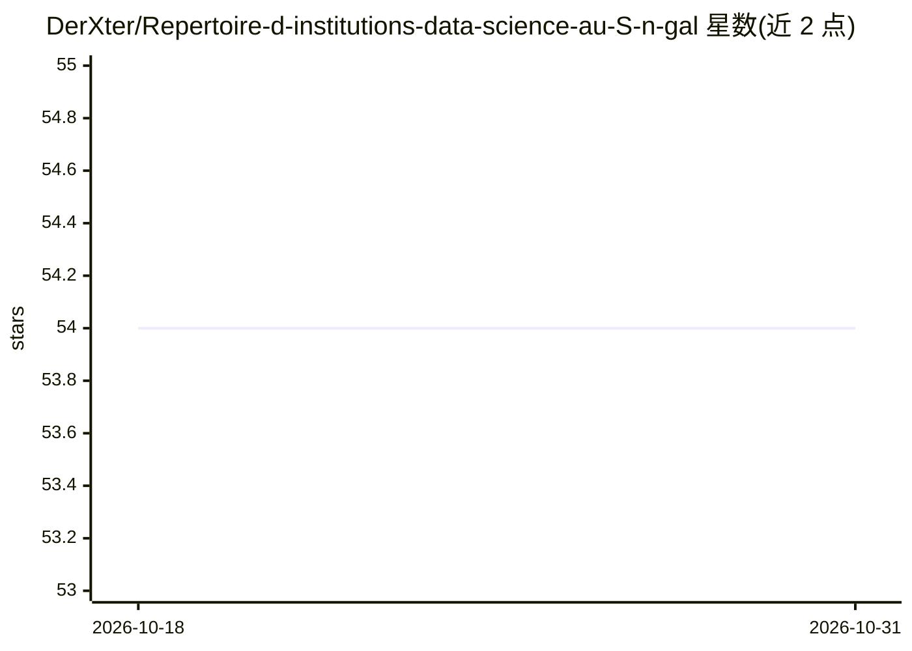

# DerXter/Repertoire-d-institutions-data-science-au-S-n-gal

⭐ 54 · MIT · 推送 2026-03-05 · [GitHub](https://github.com/DerXter/Repertoire-d-institutions-data-science-au-S-n-gal) · 个人维护

**塞内加尔 AI/数据科学相关机构名录（企业、NGO、培训机构）**

个人维护的塞内加尔机构清单，收录可在 AI、机器学习、大数据与数据科学领域接受培训或就业的企业、公共机构、NGO 与教育培训机构，按三类文件组织。作者声明该清单非官方、基于个人观察，可通过 Markdown 文件、邮件或社交媒体提交新增或纠错条目，并附贡献规范（查重、核实、按字母排序等）。另设有分享培训、实习与就业机会的 Telegram 频道。

## 筛选速览

| 维度 | 判定 | 备注 |
|---|---|---|
| AI 角色 | `ai-knowledge` | 知识聚合/清单类 |
| 许可风险 | `permissive` | MIT |
| 部署形态 | `None` |  |
| 模型依赖 | — | README 未给出锁定关系 |
| 硬件要求 | — | 无带数字的原话,不猜 |
| 安装摩擦 | `low` | 无编译、无系统依赖或容器化 |
| 成熟度 | — | 结构信号不足 |

## 能力要点

- 按私营企业、公共机构、培训机构三类组织条目
- 提供邮件与社交媒体渠道接受贡献，无需掌握 Markdown
- 配套 Telegram 频道分享培训、实习与就业机会

## 适用场景

- 在塞内加尔寻找数据科学/AI 方向的培训或学习机构
- 了解塞内加尔 AI/数据科学领域的企业与就业去向
- 发现相关的培训、实习与职位机会

## 场景标签

`精选清单` · 领域:学习与行业

## 证据(README 行号)

> L7: Ceci est une liste d'institutions (Entreprises, ONG et Établissements de formation) présentes au *Sénégal* (Afrique 
> L14: |`ENTREPRISES PRIVÉES` 🔒️|
> L15: |`ORGANISMES PUBLICS` 🏢️|
> L16: |`ÉTABLISSEMENTS DE FORMATION` ✍️|

## 星数曲线

2026-10-18 54 → 2026-10-31 54（+0）

---
*卡片 v1 · prompt 1.4 · 生成 2026-10-24 · 置信度 high · 依据 README sha `89c76072e1ff` · [字段定义](../../DATASET.md)*
