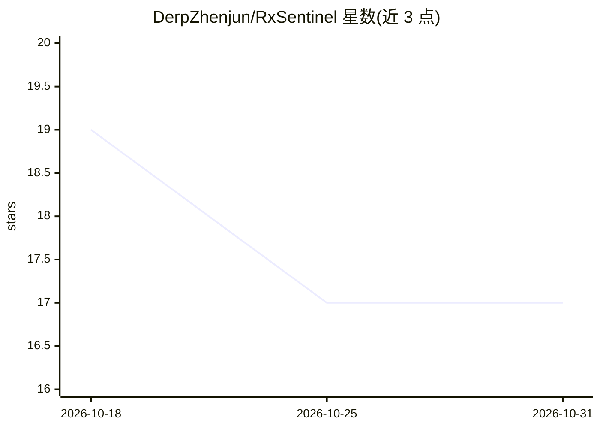

# DerpZhenjun/RxSentinel

⭐ 17 · Python · NOASSERTION · 推送 2026-06-09 · [GitHub](https://github.com/DerpZhenjun/RxSentinel) · 个人维护 · 中文 README

**处方类灰产情报全链路管线：采集/清洗/LLM结构化/入库展示**

面向处方类灰产监控的端到端情报管线系统：内置 MediaCrawler 多平台爬虫或手动导入社媒评论，经词库规则过滤后由 DeepSeek 或 Ollama 做 LLM 结构化提取，按指纹去重写入 MongoDB，通过 FastAPI、Streamlit 调度界面与 Vue 数据大屏三端访问与实时监控。快速开始要求 Python 3.12、Node.js 20 与 MongoDB 实例，start.py 一键拉起各服务；提供内置验证测试集可在无真实采集下体验 AI 结构化到大屏展示链路。使用须遵守 MediaCrawler 免责声明与平台协议。

## 筛选速览

| 维度 | 判定 | 备注 |
|---|---|---|
| AI 角色 | `ai-native` | 本体是模型或模型工具 |
| 许可风险 | `none` | NOASSERTION |
| 部署形态 | `library` | 以包/库形式分发 |
| 模型依赖 | local-ok | 支持本地模型 |
| 硬件要求 | — | 无带数字的原话,不猜 |
| 安装摩擦 | `low` | 无编译、无系统依赖或容器化 |
| 成熟度 | — | 结构信号不足 |

## 能力要点

- 四阶段管线：采集→规则清洗→LLM 结构化→指纹去重入库
- DeepSeek/Ollama 双处理器做文本结构化提取
- FastAPI HTTP API、Streamlit 调度 UI、Vue 数据大屏三端同步
- 内置验证测试集，无爬虫配置即可体验全链路

## 适用场景

- 监控社媒平台上处方类灰产线索并做 AI 研判
- 将多平台评论文本转为标准化结构化字段入库
- 通过数据大屏实时查看线索汇总与高险实体排行

## 场景标签

`网页抓取` `网络安全` · 领域:效率与自动化

## 证据(README 行号)

> L15: **RxSentinel** 是一套完整的**处方类灰产情报管线系统**。它从多平台爬虫采集或手动导入的社媒评论文本出发，经过规则过滤和**大模型结构化处理**后写入 MongoDB，再用 **Vue 数据大屏**展示，可通过 *
> L52: |**3️⃣ AI处理**|`deepseek_processor.py` / `ollama_processor.py`|使用 DeepSeek/Ollama 对文本进行结构化提取，生成标准字段|

## 星数曲线

2026-10-18 19 → 2026-10-31 17（-2）

---
*卡片 v1 · prompt 1.4 · 生成 2026-10-30 · 置信度 high · 依据 README sha `6baa7e9dfe3f` · [字段定义](../../DATASET.md)*
