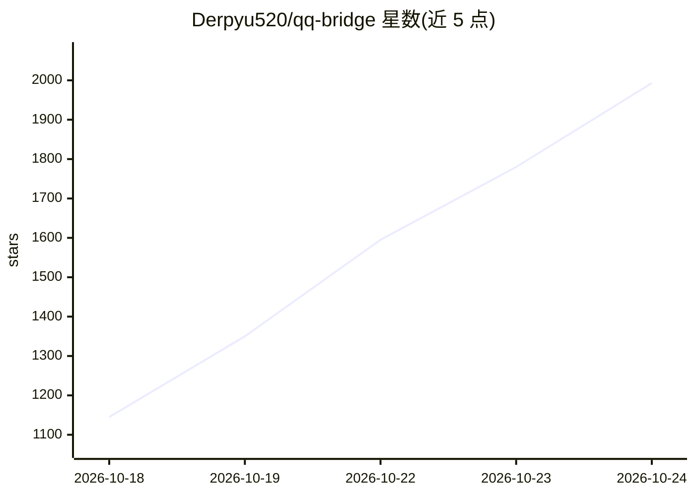

# Derpyu520/qq-bridge

⭐ 2,220 · JavaScript · NOASSERTION · 推送 2026-10-22 · [GitHub](https://github.com/Derpyu520/qq-bridge) · 个人维护 · 中文 README

**把 QQ 消息接入 DeepSeek Harness agent 的桥接程序**

运行在 SnowLuma（OneBot v11）与 DeepSeek Harness（DSH）Web API 之间的桥接进程：QQ 私聊/群消息转为 DSH 会话用户消息，agent 回复、提问与工具审批转发回 QQ。每个 QQ 会话对应独立 DSH 会话，默认模型 deepseek-flash；提供三种自研 MCP server（QQ 安全动作子集、只读探活、带 SSRF 防护的联网搜索）、四种运行模式（chat/closed-agent/一代与二代群友仿真）、黑话学习与本地 Web 控制台（含 token 花费看板、人格管理）。需 DSH 0.2.0-rc.2 与 SnowLuma 前置运行，Node.js ≥ 22.13，桥接只探测、不部署 SnowLuma。

## 筛选速览

| 维度 | 判定 | 备注 |
|---|---|---|
| AI 角色 | `ai-ecosystem` | LLM/agent 周边工具 |
| 许可风险 | `none` | NOASSERTION |
| 部署形态 | `library` | 以包/库形式分发 |
| 模型依赖 | locked-api |  |
| 硬件要求 | — | 无带数字的原话,不猜 |
| 安装摩擦 | `low` | 无编译、无系统依赖或容器化 |
| 成熟度 | — | 结构信号不足 |

## 能力要点

- QQ 会话与 DSH 会话一一映射，agent 回复/提问/工具审批双向转发
- 三个自带 MCP server：QQ 安全动作白名单子集、只读探活、SSRF 防护联网搜索
- 四种运行模式，含两代仿真群友（观望/活跃状态机、AI 自主收发消息）
- 本地 Web 控制台：token 消耗与金额看板、人格/提示词管理、模式切换

## 适用场景

- 让 DSH agent 通过 QQ 账号在群里或私聊中对话
- 把 QQ 作为 DSH 的远程控制端（工具审批通过 QQ 决策）
- 运行仿真群友，让 AI 选择性参与群聊并学习网络用语

## 场景标签

`聊天机器人` · 领域:对话与助手

## 证据(README 行号)

> L11: 把 QQ 消息接入 DSH agent：QQ 好友/群发来的消息会变成 DSH 会话里的用户消息，agent 的回复（含提问、工具审批）会发回 QQ。
> L42: QQ 消息 ──► SnowLuma（OneBot v11 WS）──► 本桥接进程 ──► DSH Web API (127.0.0.1:3080/api)
> L57: - **agent 自主收发 QQ**：DSH 的 MCP 客户端（`~/.dsh/profiles/web/cordis.patch.yml` 配置）接入三个 MCP server：

## 星数曲线

2026-10-18 1,145 → 2026-10-24 1,993（+848）

---
*卡片 v1 · prompt 1.4 · 生成 2026-10-21 · 置信度 high · 依据 README sha `cf3753f88a4c` · [字段定义](../../DATASET.md)*
