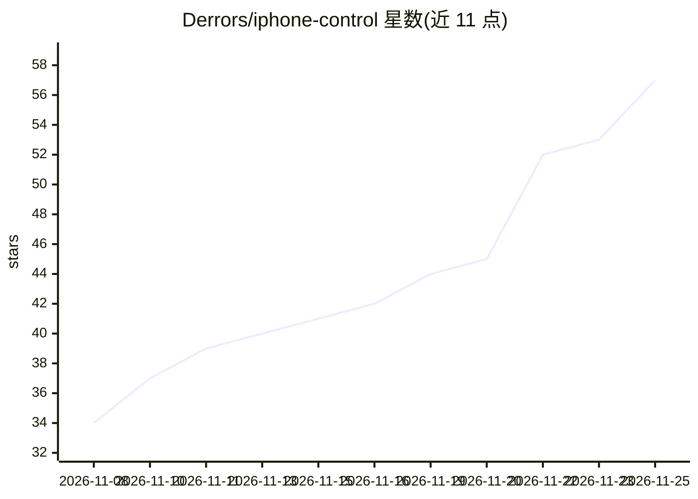

# Derrors/iphone-control

⭐ 57 · Rust · MIT · 推送 2026-11-24 · [GitHub](https://github.com/Derrors/iphone-control) · [官网](https://derrors.github.io/iphone-control/) · 个人维护 · 中文 README

**让 AI 代理通过 MCP 操作真实 USB 连接的 iPhone/iPad**

单一 Rust 二进制组成的 iOS 设备控制层：常驻 daemon 通过 USB 驱动 iPhone/iPad，以 17 个 MCP 工具（截图、点按、滑动、输入文本、启动应用、批量步骤等）供 Claude Code、Codex 等 MCP 客户端经 stdio 或 HTTP 调用；iOS 27+ 走原生控制（无 Apple ID、无需签名），iOS 17-26 走 WebDriverAgent（免费 Apple ID 签名、7 天重签）。附可选浏览器控制页（实时屏幕、接管任务）、多设备切换、自动解锁、Telegram/Bark 告警与 doctor 诊断。运行于 Linux 或 macOS，含安装脚本、Homebrew 与 .deb 安装方式。

## 筛选速览

| 维度 | 判定 | 备注 |
|---|---|---|
| AI 角色 | `ai-ecosystem` | LLM/agent 周边工具 |
| 许可风险 | `permissive` | MIT |
| 部署形态 | `None` |  |
| 模型依赖 | locked-api |  |
| 硬件要求 | — | 无带数字的原话,不猜 |
| 安装摩擦 | `low` | 无编译、无系统依赖或容器化 |
| 成熟度 | — | 结构信号不足 |

## 能力要点

- 17 个 MCP 工具覆盖截图、点按、元素树读取、应用管理与最多 20 步的批量操作
- iOS 27+ 原生控制路径：无需 Apple ID、签名与越狱
- 断线重连：拔线、重启手机、WebDriverAgent 卡死后自动恢复并在到期前重签
- 可选浏览器控制页：实时屏幕操作、任务分派与人工接管，含只读令牌

## 适用场景

- 让 Claude Code/Codex 等 AI 客户端直接操作我的 iPhone 完成任务
- 在浏览器里看 AI 操作手机并随时接管或暂停
- 在 Linux 机器上自动化测试或批量操作多台 iOS 设备

## 场景标签

`GUI 自动化` · 领域:效率与自动化

## 证据(README 行号)

> L38: |**Device control** (core)|A long-running daemon owns the phone and serves the MCP tools; recovers from unplugging 
> L151: |`mcp [--url <viewer>]`|The MCP server; your AI client starts it. With `--url` it bridges to another machine's vie

## 星数曲线

2026-11-08 34 → 2026-11-25 57（+23）

---
*卡片 v1 · prompt 1.4 · 生成 2026-11-18 · 置信度 high · 依据 README sha `833aff350477` · [字段定义](../../DATASET.md)*
