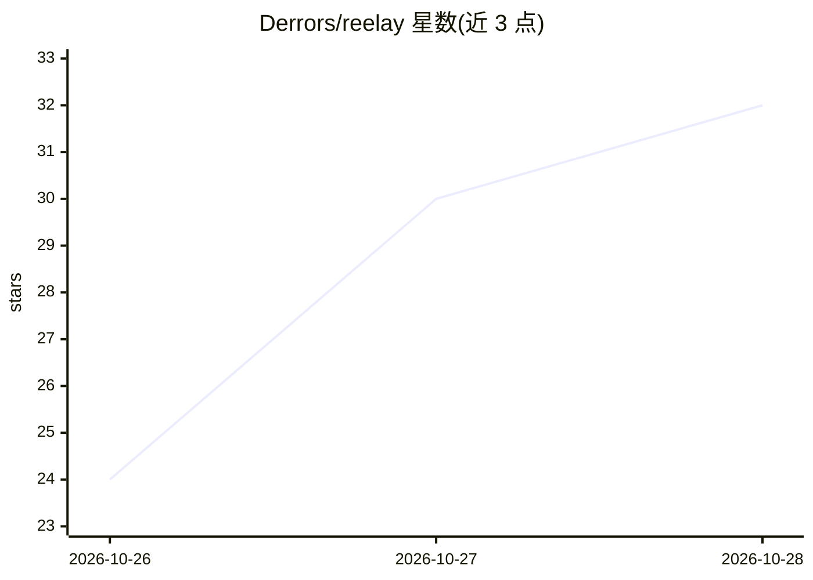

# Derrors/reelay

⭐ 32 · Python · MIT · 推送 2026-10-27 · [GitHub](https://github.com/Derrors/reelay) · [官网](https://github.com/Derrors/reelay#readme) · 个人维护 · 中文 README

**自托管的 Telegram→115 网盘自动转存与媒体库整理工具**

用用户自己的 Telegram 账号监听指定频道和 Bot，AI 识别消息中的片名、季集与版本（TMDB 校正，AI 不可用时按规则兜底），经人工在 Telegram 卡片上审批后转存到 115 网盘，按 Jellyfin/Emby 规范改名归类入库；支持订阅追剧、缺集提醒、日报。转存采用检查点与读回核验机制。入口有 Web 管理台、Telegram Bot、MCP 三种；插件以目录为单位。提供 Docker（amd64/arm64）与源码运行两种方式，支持 macOS/Linux，Windows 需用 Docker。README 提示 Telegram 自动化监听有封号、频繁调用 115 接口有风控风险。

## 筛选速览

| 维度 | 判定 | 备注 |
|---|---|---|
| AI 角色 | `ai-enhanced` | 去掉 AI 部分产品仍成立 |
| 许可风险 | `permissive` | MIT |
| 部署形态 | `self-host` | docker 或自建部署 |
| 模型依赖 | — | README 未给出锁定关系 |
| 硬件要求 | — | 无带数字的原话,不猜 |
| 安装摩擦 | `low` | 无编译、无系统依赖或容器化 |
| 成熟度 | — | 结构信号不足 |

## 能力要点

- AI 识别片名/季集/版本 + TMDB 校正，AI 不可用时规则兜底
- Web 管理台、Telegram Bot、MCP 三种入口，一个目录即一个插件
- 转存先存检查点再调接口、事后读回核验
- 订阅追剧、缺集每日提醒、播完自动结束

## 适用场景

- 追的剧集更新后自动转存进我的 115 媒体库
- 在 Telegram 上审批和修正 AI 识别结果，不打断刷剧
- 按 Jellyfin/Emby 规范自动归类改名，打开媒体服务器就能看

## 场景标签

`工作流自动化` · 领域:效率与自动化

## 证据(README 行号)

> L21: 你关注的频道和 Bot 每天刷出一堆资源，真正想要的就那几部。Reelay 用你自己的 Telegram 账号替你盯着：AI 读懂每条消息是哪部片、第几季第几集、什么版本，再由 TMDB 和分享里的真实文件替它把关；你在 Tele
> L134: **AI 提议 → 事实源校验 → 人工裁决 → 裁决回流给 AI。**

## 星数曲线

2026-10-26 24 → 2026-10-28 32（+8）

---
*卡片 v1 · prompt 1.4 · 生成 2026-10-27 · 置信度 high · 依据 README sha `1dfe157b501e` · [字段定义](../../DATASET.md)*
