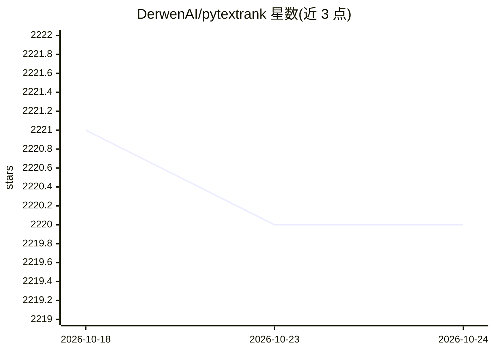

# DerwenAI/pytextrank

⭐ 2,220 · Python · MIT · 推送 2026-06-24 · [GitHub](https://github.com/DerwenAI/pytextrank) · [官网](https://derwen.ai/docs/ptr/) · 组织维护

**spaCy 扩展库：实现 TextRank 系列图算法做短语抽取与摘要**

PyTextRank 是 TextRank 的 Python 实现，以 spaCy pipeline 扩展形式提供，覆盖 TextRank、PositionRank、Biased TextRank、TopicRank 等 textgraph 算法。主要用例包括从文档中抽取 top 排序短语、低成本的抽取式摘要，以及从非结构化文本推断概念到更结构化的表示。通过 PyPI 或 conda 安装，主版本号跟随 spaCy 主版本，附带教程 notebook 与在线文档。由 Paco Nathan 及多位贡献者维护，Derwen 公司支持。

## 筛选速览

| 维度 | 判定 | 备注 |
|---|---|---|
| AI 角色 | `ai-native` | 本体是模型或模型工具 |
| 许可风险 | `permissive` | MIT |
| 部署形态 | `library` | 以包/库形式分发 |
| 模型依赖 | — | README 未给出锁定关系 |
| 硬件要求 | — | 无带数字的原话,不猜 |
| 安装摩擦 | `low` | 无编译、无系统依赖或容器化 |
| 成熟度 | — | 结构信号不足 |

## 能力要点

- 实现 TextRank、PositionRank、Biased TextRank、TopicRank 等 textgraph 算法族
- 以 spaCy pipeline 扩展形式集成
- 支持短语抽取与低成本抽取式摘要
- 提供教程 notebook 与在线文档

## 适用场景

- 从文本文档中抽取 top 排序短语
- 对文档做低成本的抽取式摘要
- 从非结构化文本推断概念到结构化表示

## 场景标签

 · 领域:自然语言处理

## 证据(README 行号)

> L13: **PyTextRank** is a Python implementation of *TextRank* as a
> L26:  - *phrase extraction*: get the top-ranked phrases from a text document
> L27:  - low-cost *extractive summarization* of a text document

## 星数曲线

2026-10-18 2,221 → 2026-10-24 2,220（-1）

---
*卡片 v1 · prompt 1.4 · 生成 2026-10-21 · 置信度 high · 依据 README sha `411f1af218bb` · [字段定义](../../DATASET.md)*
