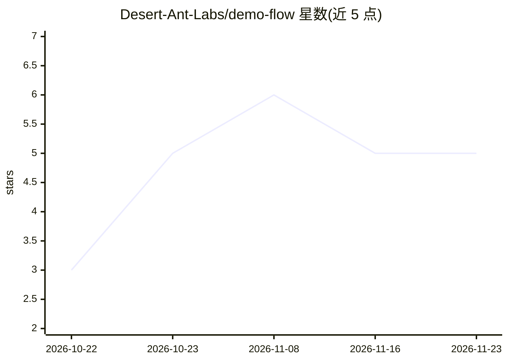

# Desert-Ant-Labs/demo-flow

⭐ 5 · Swift · MIT · 推送 2026-10-20 · [GitHub](https://github.com/Desert-Ant-Labs/demo-flow) · [官网](https://desertant.com) · 组织维护

**macOS 本地模型自动化工作台：串联设备端模型运行流程**

macOS 桌面应用，将 Desert Ant 设备端模型按步骤组合为流程并运行：语音转写与脱敏、照片打标、支持邮件分拣等。提供 Steps 列表与 Canvas 拖拽两种编排方式，支持定时、文件夹监听、来电等触发，结果可导出为 PDF/Markdown/CSV。数据不经云端处理；模型首次使用时从 Hugging Face 下载。与 flow.desertant.com 通过同一 YAML 格式互通，另有 desertant CLI 可生成流程文件。需 macOS 26 及以上、Apple Silicon。

## 筛选速览

| 维度 | 判定 | 备注 |
|---|---|---|
| AI 角色 | `ai-native` | 本体是模型或模型工具 |
| 许可风险 | `permissive` | MIT |
| 部署形态 | `None` |  |
| 模型依赖 | — | README 未给出锁定关系 |
| 硬件要求 | — | 无带数字的原话,不猜 |
| 安装摩擦 | `low` | 无编译、无系统依赖或容器化 |
| 成熟度 | — | 结构信号不足 |

## 能力要点

- Steps 列表与 Canvas 拖拽两种流程编排方式，含 34 个模板
- 定时、文件夹监听、通话开始、快捷键等自动触发运行
- 文本/音频/照片在本机处理，模型从 Hugging Face 下载且无需账号或 token
- 与 flow.desertant.com 及 desertant CLI 共享 YAML 流程文件与分享链接

## 适用场景

- 把语音备忘录转写并自动脱敏个人细节
- 对相册照片按表情或标签分类整理
- 通话中实时生成标注说话人的会议记录
- 定时或按文件夹触发自动分拣支持邮件

## 场景标签

`语音识别` `工作流自动化` `目标检测` · 领域:效率与自动化

## 证据(README 行号)

> L5: Build flows out of Desert Ant's on-device models and run them on your Mac. A flow can transcribe a voice memo and ma
> L45: Flow runs the Desert Ant models for speech, text, and photos. The site lists each one and what it does.

## 星数曲线

2026-10-22 3 → 2026-11-23 5（+2）

---
*卡片 v1 · prompt 1.4 · 生成 2026-11-21 · 置信度 high · 依据 README sha `f05522df3ed4` · [字段定义](../../DATASET.md)*
