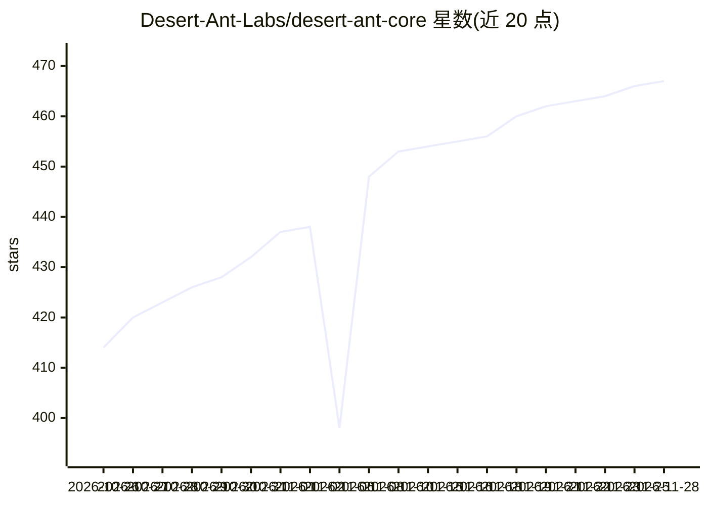

# Desert-Ant-Labs/desert-ant-core

⭐ 467 · Swift · NOASSERTION · 推送 2026-11-25 · [GitHub](https://github.com/Desert-Ant-Labs/desert-ant-core) · [官网](https://desertant.com) · 组织维护

**给移动/Web 应用开发者的离线端侧模型 SDK 套件**

一组端侧运行的小模型集合，覆盖语音识别、去噪、PII 脱敏、表情推荐、图片理解、人脸匹配、话题标注、NSFW 检测、说话人分离等 17 个模型，通过 Swift、Kotlin、JavaScript/TypeScript SDK 在 iOS/macOS/Android/Web/Node 上完全离线运行，底层使用 Core ML 与 LiteRT（Web 端 WebAssembly）。模型权重公开在 Hugging Face，首次使用时由 SDK 下载并缓存，版本固定校验。生产环境需在 platform.desertant.com 申请免费 API key。另有 CLI 及面向编码 agent 的技能配置。

## 筛选速览

| 维度 | 判定 | 备注 |
|---|---|---|
| AI 角色 | `ai-native` | 本体是模型或模型工具 |
| 许可风险 | `none` | NOASSERTION |
| 部署形态 | `library` | 以包/库形式分发 |
| 模型依赖 | — | README 未给出锁定关系 |
| 硬件要求 | — | 无带数字的原话,不猜 |
| 安装摩擦 | `low` | 无编译、无系统依赖或容器化 |
| 成熟度 | `idea` | |

## 能力要点

- 17 个端侧模型，涵盖语音、图像、文本处理，全部离线运行
- Swift/Kotlin/JS 三套 SDK，覆盖 Apple/Android/Web/Node 平台
- 模型权重公开在 Hugging Face，SDK 内置下载校验与缓存机制
- Android 端通过 LiteRT GPU 加速器运行，无 GPU 时回退 CPU

## 适用场景

- 在 App 内做离线语音转写与填充词检测
- 对用户文本/音频做端侧 PII 脱敏，数据不出设备
- 给图片库加离线场景、人脸、画质分析
- 在浏览器端做语言识别或内容话题标注

## 场景标签

`语音识别` `人脸识别` · 领域:感知与多模态

## 证据(README 行号)

> L9: Add on-device speech recognition, audio cleanup, PII redaction, emoji suggestion, and more to your app, with SDKs fo
> L24: |Model|What it does|Platform|Docs|
> L41: |**Voz**|On-device speech recognition: transcripts with word-level timestamps, 25 languages.|Apple · Android · Linu

## 星数曲线

2026-10-26 414 → 2026-11-28 467（+53）

---
*卡片 v1 · prompt 1.4 · 生成 2026-11-26 · 置信度 high · 依据 README sha `d29e9684a044` · [字段定义](../../DATASET.md)*
