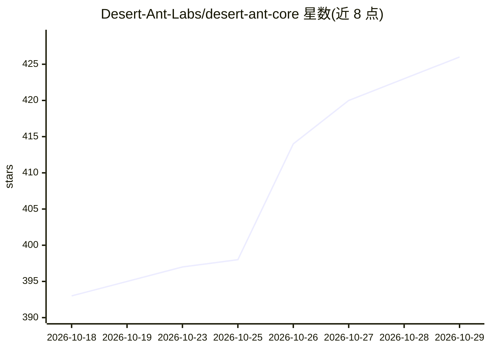

# Desert-Ant-Labs/desert-ant-core

⭐ 426 · Swift · NOASSERTION · 推送 2026-10-27 · [GitHub](https://github.com/Desert-Ant-Labs/desert-ant-core) · [官网](https://desertant.com) · 组织维护

**端侧 AI SDK 套件：为 App 提供离线语音、图像与文本小模型**

面向移动与 Web 开发者的设备端模型 SDK 集合，提供 Swift、Kotlin、JavaScript 三种语言接入，涵盖语音识别（Voz）、语音增强（Clear）、PII 检测与脱敏（Redact）、照片理解（Eye）、NSFW 检测（Moderator）、话题标签（Gist）等 15 个已发布模型及 3 个封闭测试模型。模型权重托管于 Hugging Face，首次使用时下载并缓存，支持完全离线与气隙运行；运行时基于 Core ML、LiteRT 与 WebAssembly。限制：Swift 包要求 iOS 18+/macOS 15+；模型按月向许可服务器激活（Tongue 除外），离线可正常运行。另提供 macOS/Linux CLI。

## 筛选速览

| 维度 | 判定 | 备注 |
|---|---|---|
| AI 角色 | `ai-native` | 本体是模型或模型工具 |
| 许可风险 | `none` | NOASSERTION |
| 部署形态 | `library` | 以包/库形式分发 |
| 模型依赖 | — | README 未给出锁定关系 |
| 硬件要求 | — | 无带数字的原话,不猜 |
| 安装摩擦 | `low` | 无编译、无系统依赖或容器化 |
| 成熟度 | `idea` | |

## 能力要点

- 15 个已发布设备端模型，覆盖语音、图像、文本三类任务
- Swift/Kotlin/JavaScript 三平台 SDK，模型完全离线运行，数据不出设备
- 模型权重托管 Hugging Face，SDK 版本固定模型修订版并校验下载
- 提供 CLI（desertant），命令间以 JSON 传递，可为编码 agent 写入技能

## 适用场景

- 在 iOS/Android/Web 应用中集成离线语音识别与音频降噪
- 对用户文本或通话记录做端上 PII 检测与脱敏
- 为本地编码 agent 配置 CLI 技能，终端内转录、切片与清洗音频

## 场景标签

`语音识别` · 领域:感知与多模态

## 证据(README 行号)

> L9: Add on-device speech recognition, audio cleanup, PII redaction, emoji suggestion, and more to your app, with SDKs fo
> L24: |Model|What it does|Platform|Docs|

## 星数曲线

2026-10-18 393 → 2026-10-29 426（+33）

---
*卡片 v1 · prompt 1.4 · 生成 2026-10-21 · 置信度 high · 依据 README sha `35edbd252f8e` · [字段定义](../../DATASET.md)*
